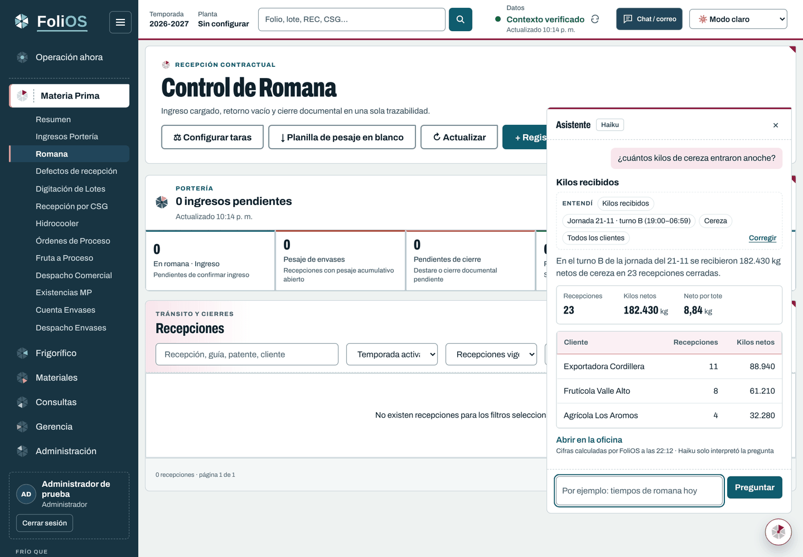
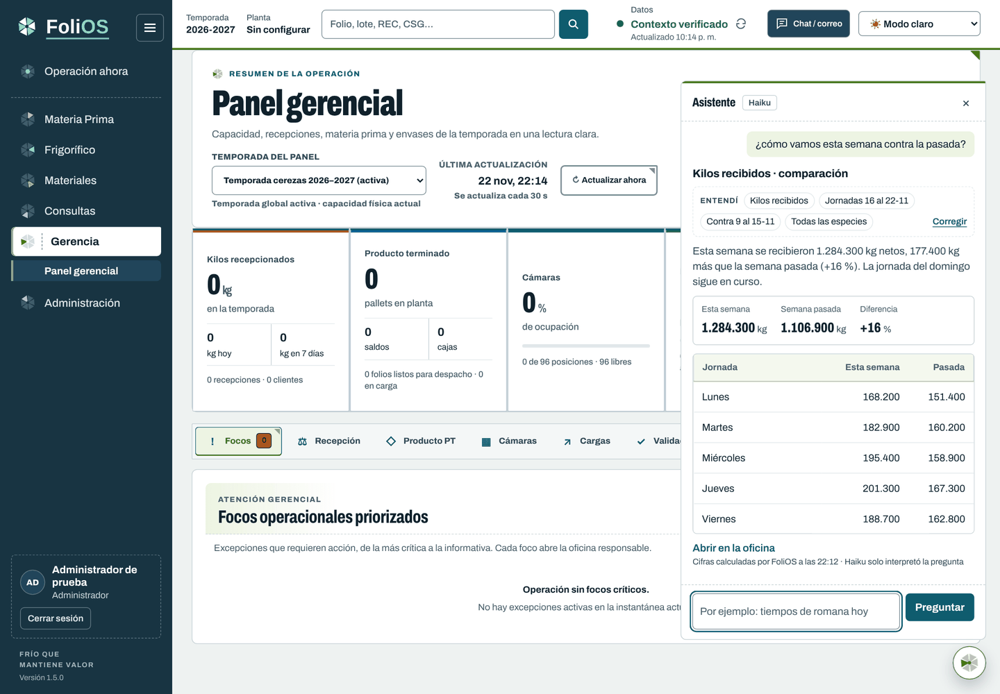
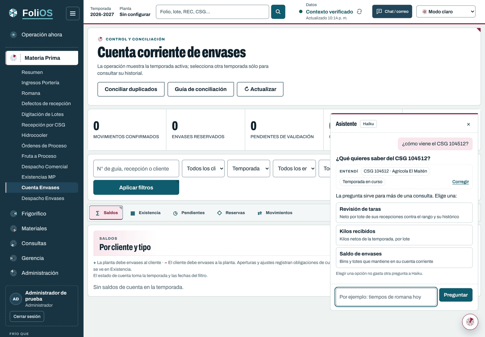
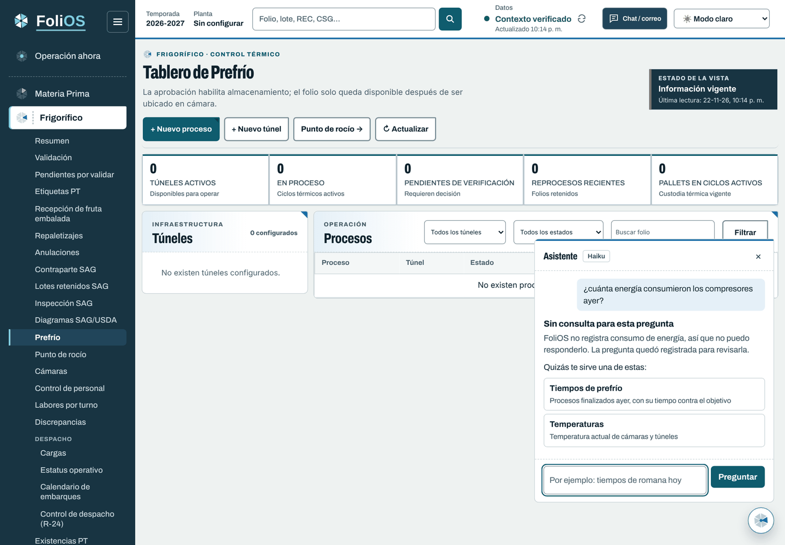
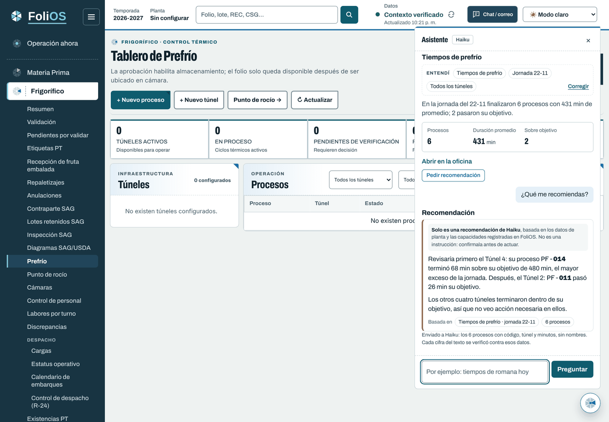
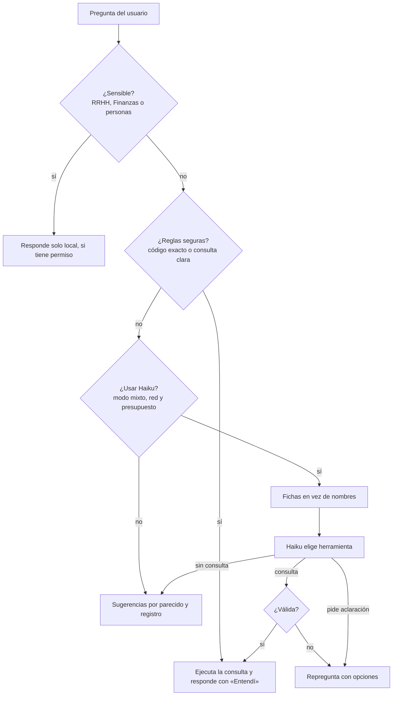

# Asistente de Oficina · Fase B con Haiku: estudio con las consultas reales de la planta

**Fecha:** 22-11-2026. **Estado:** aprobado por L.K.S. como plan de trabajo. Complementa [`ASISTENTE_OFICINA.md`](ASISTENTE_OFICINA.md) y el [diseño original](superpowers/specs/2026-11-22-asistente-oficina-design.md).

## Lo importante

Haiku debe entrar como **intérprete**, no como fuente de datos: elige la consulta y sus filtros, y FoliOS calcula y redacta la respuesta. Así ninguna cifra sale del modelo, y los datos operacionales solo salen de la planta cuando el usuario pide una recomendación.

- **El vacío principal es el catálogo, no el lenguaje.** De 60 preguntas reales de la planta, 39 no tienen consulta que las responda y 10 reciben hoy una respuesta falsa. Haiku no arregla eso: sin consulta no hay dato.
- **Haiku aporta en lo que las reglas no pueden:** «anoche», «el martes», «turno B», «en la temporada», comparaciones entre periodos y el nombre del cliente dicho a medias. Sin datos, pide aclaración en vez de adivinar.
- **Primero hay que corregir la fase A.** Hoy las reglas «entienden» mal algunas preguntas y las responden con seguridad. En modo mixto esas preguntas nunca llegarían a Haiku.
- **El costo no es la restricción.** Con este diseño cada pregunta cuesta del orden de US$0,0001 a 0,0007. Quince mil preguntas al mes salen entre US$1,5 y US$10,5. Los topes siguen, como resguardo.
- **Orden de trabajo:** corregir la fase A, armar el banco de preguntas como prueba, agregar las consultas que faltan y recién después conectar Haiku.

## Decisiones tomadas (22-11-2026)

- El banco de preguntas tiene 60 preguntas y crece con las preguntas no respondidas de producción.
- Tope de gasto inicial: **US$20 al mes**, en FoliOS y en la cuenta de Anthropic.
- Límite: **entre 50 y 60 preguntas a Haiku por usuario al día**.
- El servidor de planta **tiene salida HTTPS**.
- Umbral de la compuerta: 15 % de preguntas reales que terminan en sugerencias.
- **Recomendaciones:** solo si el usuario las pide y la respuesta dice que es solo una recomendación basada en los datos y las capacidades de la planta (ver más abajo).

## Punto de partida: la fase A (#719)

La fase A tiene 12 consultas y un intérprete por palabras clave. Reconoce estos periodos: hoy, ayer, esta semana, semana pasada, este mes, mes pasado, fechas escritas y «temporada pasada». Reconoce estos códigos: `REC-`, `CAR-`, `PF-` y números de 5 dígitos o más, que busca como folio.

Las 12 consultas: tiempos de Romana, kilos recibidos, kilos por CSG, revisión de taras, cajas PT, formatos PT, saldos PT, repaletizajes, tiempos de prefrío, tiempos de cargas, consumos por OT y búsqueda por código.

Estos problemas se comprobaron contra el código de main. Todos deben corregirse antes de conectar Haiku:

1. **Día de calendario en vez de jornada.** «Hoy» va de 00:00 a 23:59. La planta usa la jornada de 07:00 a 06:59, que ya resuelve `CalendarioOperativo`. Las cifras no cuadran con Operación ahora.
2. **Filtros ignorados sin aviso.** La especie se reconoce pero ninguna consulta la usa. El CSG solo lo usa «kilos por CSG». Prefrío, cargas y repaletizajes no filtran por cliente.
3. **Respuestas a la pregunta equivocada.** «Cuántos pallets despachamos ayer» responde con la existencia actual. «Temperatura de los túneles» responde con los tiempos de prefrío.
4. **Sugerencias poco útiles.** Sin coincidencias propone las tres primeras consultas del catálogo, no las más parecidas.
5. **Temporada de prueba.** «Temporada pasada» busca por fecha de creación y puede tomar una temporada de prueba. Existe `Temporada::productivas()` para evitarlo.

La respuesta tampoco muestra qué entendió el asistente, así que el usuario no puede detectar ninguno de estos errores.

## Banco de preguntas reales de la planta

De 60 preguntas que la planta hace a diario, la fase A responde bien 9. Otras 4 necesitan entender mejor el lenguaje, 6 necesitan un filtro que su consulta no tiene, 39 necesitan una consulta nueva y 2 deben quedarse dentro de la planta. Hoy 10 de las 60 reciben una respuesta falsa: otra consulta, otro periodo o un filtro ignorado.

La columna «Hoy» se probó contra una copia local de main: muestra qué consulta eligió el intérprete. Valle Alto y el CSG 104512 son ejemplos inventados.

| # | Área | Pregunta | Consulta que la responde | Hoy en la fase A | Clase |
| --- | --- | --- | --- | --- | --- |
| 1 | Romana | ¿Cuánto se demoraron los camiones hoy? | tiempos-romana | Responde, con día de calendario | Reglas bastan |
| 2 | Romana | ¿Qué camiones siguen esperando destare? | tiempos-romana | Los muestra en la tabla, sin filtrar | Reglas bastan |
| 3 | Romana | ¿Cuántos kilos entraron anoche? | kilos-recepciones | No reconoce «anoche»: solo sugiere | Haiku aporta |
| 4 | Romana | ¿Cuántos kilos de cereza recibimos hoy? | kilos-recepciones | Suma todas las especies | Falta un filtro |
| 5 | Romana | Kilos de Valle Alto esta semana | kilos-recepciones | Responde | Reglas bastan |
| 6 | Romana | ¿Cuántos kilos lleva el CSG 104512 en la temporada? | kilos-por-csg | Responde solo hoy | Haiku aporta |
| 7 | Romana | Revisa las taras de hoy | revisar-taras | Responde | Reglas bastan |
| 8 | Romana | ¿Cómo viene el CSG 104512? | revisar-taras con histórico del CSG | Responde kilos por CSG de hoy | Falta un filtro |
| 9 | Romana | ¿Cuánto da el neto por tote por CSG esta semana? | kilos-por-csg con neto por envase | No calcula esa cifra | Falta la consulta |
| 10 | Romana | ¿Cuántos bins y totes entraron hoy? | Nueva: envases recibidos | Sin consulta | Falta la consulta |
| 11 | Romana | ¿Qué recepciones esperan digitación de lote? | Nueva: lotes por digitar | Sin consulta | Falta la consulta |
| 12 | Romana | ¿Cuánto demora la Validación MP? | Nueva: tiempos de Validación MP | Sin consulta | Falta la consulta |
| 13 | Romana | ¿Cómo estuvo el agua del hidrocooler hoy? | Nueva: hidrocooler | Sin consulta | Falta la consulta |
| 14 | Romana | ¿Qué camiones hay en patio ahora? | Nueva: camiones en planta (Portería y Romana) | Sin consulta; sugiere tiempos de Romana | Falta la consulta |
| 15 | Romana | ¿Cuántos totes llegaron vacíos hoy en Validación MP? | Nueva: envases vacíos en Validación MP | Sin consulta; sugiere revisión de taras | Falta la consulta |
| 16 | Romana | ¿Qué pesajes se corrigieron esta semana? | Nueva: correcciones de Romana | Sin consulta | Falta la consulta |
| 17 | Romana | ¿Qué camiones salieron con envases en el destare hoy? | Nueva: salidas con envases | Responde tiempos de Romana | Falta la consulta |
| 18 | Envases | ¿Cuántos bins nos debe el CSG 104512? | Nueva: saldo de envases | Sin consulta | Falta la consulta |
| 19 | Envases | ¿Qué pasó con la guía 2588? | búsqueda por código | No reconoce guías de 4 dígitos ni `GDE-` | Falta un filtro |
| 20 | Envases | ¿Qué despachos de envases siguen en borrador? | Nueva: despachos de envases | Sin consulta | Falta la consulta |
| 21 | Envases | ¿Qué guías están reasignadas a otro CSG? | Nueva: reasignaciones | Sin consulta | Falta la consulta |
| 22 | Envases | Estado de cuenta de envases de Valle Alto de este mes | Nueva: estado de cuenta de envases | Sugiere formatos PT por la palabra «envases» | Falta la consulta |
| 23 | Envases | ¿Cuántos bins arrendados quedan en existencia? | Nueva: existencia de envases por propiedad | Sugiere cajas PT | Falta la consulta |
| 24 | Proceso | ¿Qué falta por validar? | Nueva: pendientes por validar | Sin consulta | Falta la consulta |
| 25 | Proceso | ¿Cuántas cajas se embalaron ayer para Valle Alto? | Nueva: cajas por día de proceso | Sugiere la existencia de cajas | Falta la consulta |
| 26 | Proceso | ¿Cuántas cajas hay por formato? | formatos-pt | Responde | Reglas bastan |
| 27 | Proceso | ¿Qué lotes entran a proceso en el turno A? | Nueva: órdenes de proceso | Sin consulta ni turnos | Falta la consulta |
| 28 | Proceso | ¿Qué diferencias tiene la cuadratura de hoy? | Nueva: cuadraturas | Sin consulta | Falta la consulta |
| 29 | Proceso | ¿Cuántos kilos se procesaron en la línea 3 en el turno B? | Nueva: proceso por línea y turno | Sin consulta ni turnos | Falta la consulta |
| 30 | Proceso | ¿Qué lotes siguen en resguardo sin proceso? | Nueva: existencias MP | Sin consulta | Falta la consulta |
| 31 | Proceso | ¿Cuántos folios se validaron hoy? | Nueva: validaciones PT del día | Responde la existencia actual | Falta la consulta |
| 32 | Frío | ¿Cuánto demoró el prefrío hoy? | tiempos-prefrio | Responde | Reglas bastan |
| 33 | Frío | ¿Qué túneles van atrasados ahora? | Nueva: prefrío en curso | Sugiere tiempos de procesos terminados | Falta la consulta |
| 34 | Frío | ¿Qué temperatura tienen los túneles? | Nueva: temperaturas | Responde tiempos de prefrío | Falta la consulta |
| 35 | Frío | ¿Cómo viene el punto de rocío? | Nueva: punto de rocío | Sin consulta | Falta la consulta |
| 36 | Frío | ¿Cuánta ocupación tienen las cámaras? | Nueva: ocupación de cámaras | Sin consulta | Falta la consulta |
| 37 | Frío | ¿Dónde está el folio 1234567? | búsqueda por código | Responde | Reglas bastan |
| 38 | Frío | ¿Cuántos saldos tiene Valle Alto? | saldos-pt | Responde | Reglas bastan |
| 39 | Frío | ¿Qué repas se hicieron ayer para Valle Alto? | repaletizajes | Ignora el cliente | Falta un filtro |
| 40 | Frío | ¿Qué lotes están retenidos por SAG? | Nueva: lotes retenidos SAG | Sin consulta | Falta la consulta |
| 41 | Frío | ¿Qué pallets llevan más de 3 días en cámara? | Nueva: antigüedad en cámara | Sugiere cajas PT | Falta la consulta |
| 42 | Frío | ¿Qué maniobras están pausadas? | Nueva: maniobras pausadas | Sin consulta | Falta la consulta |
| 43 | Frío | ¿Qué folios se anularon esta semana? | Nueva: anulaciones | Responde la existencia actual | Falta la consulta |
| 44 | Despacho | ¿Cuántos pallets despachamos ayer? | Nueva: despachos PT por día | Responde la existencia actual | Falta la consulta |
| 45 | Despacho | ¿Cómo va la carga CAR-000059? | Nueva: avance de carga | La busca como código, sin su avance | Falta la consulta |
| 46 | Despacho | ¿Cuánto demoró el carguío de Valle Alto? | tiempos-cargas | Ignora el cliente | Falta un filtro |
| 47 | Despacho | ¿Qué cargas están listas para cerrar? | Nueva: estado de cargas | Sin consulta | Falta la consulta |
| 48 | Despacho | ¿Qué embarques salen mañana? | Nueva: calendario de embarques | Sin consulta; no reconoce «mañana» | Falta la consulta |
| 49 | Despacho | ¿Qué pallets volvieron de cargas esta semana? | Nueva: retornos de carga | Sin consulta | Falta la consulta |
| 50 | Despacho | ¿Cuántas cajas despachamos a Estados Unidos esta temporada? | Nueva: despachos PT por destino | Sugiere cajas PT | Falta la consulta |
| 51 | Materiales | ¿Cuánto se consumió en las OT de ayer? | consumos-ot | Responde, por fecha de registro | Reglas bastan |
| 52 | Materiales | ¿Qué ítems están bajo mínimo? | Nueva: reposición | Sin consulta | Falta la consulta |
| 53 | Materiales | ¿Qué vence este mes en bodega? | Nueva: vencimientos | Sin consulta | Falta la consulta |
| 54 | Materiales | ¿Cuántas cajas de cartón le quedan a Valle Alto? | Nueva: existencias de materiales | Sin consulta | Falta la consulta |
| 55 | Materiales | ¿Qué recepciones provisionales de materiales vencen esta semana? | Nueva: recepciones provisionales | Sin consulta | Falta la consulta |
| 56 | Gerencia | Kilos de esta semana contra la pasada | kilos-recepciones en dos periodos | Responde un solo periodo | Haiku aporta |
| 57 | Gerencia | ¿Cómo vamos contra la temporada pasada? | kilos-recepciones en dos temporadas | Puede tomar una temporada de prueba | Haiku aporta |
| 58 | Gerencia | ¿Qué día de la semana entró más fruta? | kilos-recepciones agrupados por día | No agrupa; solo sugiere | Falta un filtro |
| 59 | Frío | ¿Cuántas horas extra hizo el turno B? | Nueva: control de personal | Sin consulta | Solo local |
| 60 | Administración | ¿Cuánto va la prefactura de Valle Alto este mes? | Nueva: prefactura | Sin consulta | Solo local |

## Dónde aporta Haiku y dónde no

Haiku solo resuelve el lenguaje. En el banco, eso decide 4 de 60 preguntas por sí solo; otras 45 dependen de filtros y consultas que hay que construir igual, con o sin IA.

| Clase | Preguntas | Qué la resuelve | Rol de Haiku |
| --- | --- | --- | --- |
| Reglas bastan | 9 | Las reglas actuales, con la jornada corregida | Ninguno |
| Haiku aporta | 4 | Traducir «anoche», «en la temporada» o «contra la pasada» a filtros que FoliOS calcula | Principal |
| Falta un filtro | 6 | Agregar especie, CSG, cliente o «agrupar por día» a la consulta, y reconocer guías | Entiende el filtro, pero sin él la cifra sale mal igual |
| Falta la consulta | 39 | Consultas nuevas que reutilicen los servicios de cada oficina | Ninguno: sin consulta no hay dato |
| Solo local | 2 | Reglas locales con permisos de RRHH o Finanzas | Nunca se envía |

- **Varias frases se pueden resolver con reglas.** «Anoche» es el turno B de la jornada anterior, y «mañana», «turno A» o «el martes» son patrones fijos. Agregarlos cuesta poco y no depende de la red.
- **Haiku gana valor cuando el catálogo crece.** Con 12 consultas bastan las palabras clave. Con 35 aumentan los choques: «tiempo» ya aparece en tres consultas y «envase» ya es de formatos PT y lo será también de la cuenta de envases.
- **Las preguntas ambiguas necesitan una repregunta.** «¿Cómo viene el CSG 104512?» puede ser kilos o taras. Haiku puede ofrecer las opciones en vez de elegir una.

**Compuerta medible:** conectar Haiku solo si, con la fase A corregida y las consultas nuevas, más del 15 % de las preguntas reales siguen terminando en sugerencias.

## Diseño de la integración

Haiku recibe la pregunta y el catálogo como herramientas, y contesta solo con una llamada a una de ellas. FoliOS valida esa llamada, ejecuta la consulta y arma la respuesta como hoy.

1. **Una sola llamada, forzada a herramienta.** Se usa `tool_choice: any` con herramientas `strict: true`, así los parámetros siempre cumplen el esquema. Con uso forzado, la respuesta empieza por la llamada y no trae bloque de pensamiento.
2. **Una herramienta por consulta, más dos especiales.** `pedir_aclaracion` devuelve una pregunta con 2 a 4 opciones. `sin_consulta` explica por qué nada calza y queda en el registro.
3. **Cada consulta declara sus filtros.** La misma declaración alimenta las reglas y el esquema de Haiku. Un filtro que la consulta no admite no se puede pedir, y las reglas avisan en vez de ignorarlo.
4. **Parámetros comunes:** periodo (jornada, turno, rango, temporada o temporada anterior), cliente, CSG, especie, código, `comparar_con` y `agrupar_por`. FoliOS calcula las comparaciones y agrupaciones; Haiku solo las pide.
5. **FoliOS pone el contexto.** El prompt de sistema lleva la fecha y hora, la jornada de 07:00 a 06:59, los turnos A (07:00 a 18:59) y B (19:00 a 06:59) y un glosario corto: REPA, saldo, CSG, destare, `REC-`, `CAR-`, `PF-`, `GDE-`. FoliOS convierte el periodo con `CalendarioOperativo`.
6. **Nombres reemplazados antes de enviar.** El reconocedor local cambia clientes, productores y personas por fichas: «kilos de [CLIENTE_1] esta semana». Haiku devuelve la ficha y FoliOS la traduce.
7. **Validación local antes de ejecutar:** permiso del usuario, temporada, fichas existentes, filtros admitidos y fechas dentro de la temporada. Si algo falla, no se ejecuta: se repregunta.
8. **La respuesta la arma FoliOS.** Sale del `ResultadoConsulta` con una línea «Entendí» construida desde los parámetros validados, con un enlace para corregir.
9. **Segunda llamada solo para recomendaciones.** Las respuestas con datos no la usan.

Ejemplo de herramienta. Las especies van en el esquema porque son productos; los nombres de clientes nunca, porque los esquemas estrictos se guardan hasta 24 horas en Anthropic.

```json
{
  "name": "kilos_recibidos",
  "description": "Kilos brutos, tara y netos de recepciones cerradas en Romana. Cada recepción cuenta en la jornada en que entró el camión.",
  "strict": true,
  "input_schema": {
    "type": "object",
    "properties": {
      "periodo_tipo": { "type": "string", "enum": ["jornada", "turno", "rango", "temporada", "temporada_anterior"] },
      "desde": { "type": "string", "format": "date" },
      "hasta": { "type": "string", "format": "date" },
      "turno": { "type": "string", "enum": ["A", "B", "ambos"] },
      "cliente": { "type": "string", "description": "Ficha CLIENTE_n de la pregunta, o vacío" },
      "especie": { "type": "string", "enum": ["todas", "cereza", "arandano"] },
      "comparar_con": { "type": "string", "enum": ["nada", "periodo_anterior", "temporada_anterior"] },
      "agrupar_por": { "type": "string", "enum": ["nada", "jornada", "turno", "cliente", "csg"] }
    },
    "required": ["periodo_tipo"],
    "additionalProperties": false
  }
}
```

## Qué recibe el usuario

Con Haiku, el usuario recibe el mismo tipo de respuesta que sin IA, más la línea «Entendí» para comprobar qué se calculó. Todo texto con cifras lo escribe FoliOS con plantillas fijas. Las imágenes de [`asistente/estudio/`](asistente/estudio/) son simulaciones sobre el panel real, con cifras y nombres inventados.

| Caso | Qué ve | Insignia |
| --- | --- | --- |
| Respuesta con datos | Título; línea «Entendí» con fichas y «Corregir»; resumen de una frase; cifras; tabla; «Abrir en la oficina» con los mismos filtros; pie «Cifras calculadas por FoliOS a las HH:MM» | Haiku |
| Comparación | Lo mismo, con los dos totales y la diferencia calculados por FoliOS, y la tabla lado a lado | Haiku |
| Repregunta | Lo que se entendió y 2 a 4 opciones; elegir una ejecuta la consulta sin otra llamada a Haiku | Haiku |
| Sin consulta | Dice que FoliOS no tiene ese dato o esa consulta, registra la pregunta y ofrece las consultas más cercanas | Haiku |
| Tema sensible | Responde solo con reglas locales, si el usuario tiene permiso, y avisa que la pregunta no salió de la planta | Sin IA |
| Haiku no disponible | Responde con reglas y dice por qué: tope del mes, límite diario o sin red | Sin IA |

- **«Corregir»** abre las fichas como campos editables (consulta, periodo, cliente, especie). Al cambiarlas se ejecuta de nuevo sin llamar a Haiku, y la corrección queda en el registro para el banco.
- **Nunca recibe** cifras que FoliOS no haya verificado, recomendaciones que no pidió, pronósticos ni datos de otra temporada sin que la línea «Entendí» lo diga.
- **Panel más amplio:** 440 px de ancho y hasta 860 px de alto. Al llegar una respuesta, el historial se ubica al inicio de la pregunta, no al final.

| Dato con «Entendí» | Comparación |
| --- | --- |
|  |  |
| **Repregunta** | **Sin consulta** |
|  |  |

## Recomendaciones, solo si se piden

El usuario puede recibir una recomendación con dos condiciones: que la pida, y que la respuesta diga que es solo una recomendación basada en los datos y las capacidades de la planta.

1. **Solo a pedido.** Con el botón «Pedir recomendación» bajo una respuesta con datos, o con una pregunta que la pida («¿qué me recomiendas?»). Nunca aparece sola.
2. **El aviso lo pone FoliOS, siempre.** Va fijo sobre el texto: «Solo es una recomendación de Haiku, basada en los datos de planta y las capacidades registradas en FoliOS. No es una instrucción: confírmala antes de actuar». Haiku también debe decirlo en un campo obligatorio de su respuesta, pero la condición no depende de que el modelo lo escriba.
3. **Se basa solo en lo que se mostró.** Haiku recibe el resultado de esa consulta y las capacidades que vienen al caso (túneles, cámaras, posiciones, líneas), con fichas en vez de nombres y sin campos de texto libre.
4. **Cifras verificadas.** Cada número del texto debe estar en los datos enviados. Si no está, FoliOS no muestra la recomendación y lo registra. La respuesta indica en qué datos se basó.
5. **Límites.** Es solo lectura y nunca ejecuta nada. No hay recomendaciones sobre RRHH, Finanzas o personas, ni sobre una consulta sin datos. Cada recomendación cuenta como una pregunta en el límite diario.
6. **Registro.** Se guarda qué datos se enviaron y qué respondió Haiku, para revisar.

Costo: una segunda llamada con unos 2.000 tokens de datos y 300 de respuesta, menos de US$0,001 cada una, dentro del tope de US$20.



## Enrutamiento del modo mixto

Las reglas responden solo lo que entienden con certeza; todo lo demás va a Haiku o a sugerencias, nunca a una respuesta adivinada.



«Reglas seguras» significa un código exacto, o una consulta con su palabra de objeto (kilos, taras, saldos) y todos los filtros reconocidos admitidos por ella.

## Qué sale de la planta

Solo salen la pregunta, con los nombres conocidos reemplazados, y la descripción del catálogo. Los resultados solo salen cuando el usuario pide una recomendación.

| Qué | ¿Sale? | Detalle |
| --- | --- | --- |
| Texto de la pregunta | Sí, con fichas | Un nombre que el reconocedor no conoce sale tal como se escribió |
| Catálogo de consultas | Sí | Sin datos y sin nombres en los esquemas |
| Fecha, jornada y glosario | Sí | Son reglas de operación, no datos |
| Resultados de las consultas | Solo si pide una recomendación | El resultado de esa consulta, con fichas y sin texto libre |
| Preguntas de RRHH o Finanzas | No | Las detiene el filtro previo y se responden localmente |
| Nombres de trabajadores o conductores | No | Si aparecen, la pregunta no sale |
| Patentes y números de guía | Sí, si están en la pregunta | Por decidir si también se reemplazan por fichas |

**Qué hace Anthropic con lo que recibe.** Según la [política de retención de la API](https://platform.claude.com/docs/en/manage-claude/api-and-data-retention), las preguntas y respuestas no se guardan por defecto y no se usan para entrenar sin permiso expreso. Haiku no está entre los modelos que exigen 30 días de retención. Hay dos excepciones: el contenido marcado por los sistemas de seguridad puede guardarse hasta 2 años, y los esquemas estrictos se guardan hasta 24 horas. Por eso ningún nombre va en un esquema.

**Inyección de instrucciones.** Los resultados solo vuelven a Haiku en una recomendación, y sin campos de texto libre, así que un texto guardado en FoliOS, como una observación, no puede darle órdenes. La validación local impide que Haiku pida una consulta que el usuario no puede ver.

**Red y clave.** El servidor de planta tiene salida HTTPS hacia `api.anthropic.com` (confirmado el 22-11-2026); si se corta, el asistente sigue en modo sin IA. La clave de la API va en el `.env` del servidor, nunca en la base de datos ni en la pantalla.

## Costos con el precio vigente

Precios de Haiku 5.5 según la [página del modelo](https://platform.claude.com/docs/en/models/haiku-5-5/overview), para prompts de hasta 100.000 tokens, en US$ por millón de tokens: entrada 0,10; salida 0,50; lectura de caché 0,01; escritura de caché 0,125 (5 minutos) o 0,20 (1 hora). La caché exige un prefijo de al menos 512 tokens.

Supuestos por pregunta: 5.000 tokens de prefijo fijo (sistema y unas 25 herramientas), 150 tokens variables y 120 de salida. Volumen: 20 usuarios, 25 preguntas al día cada uno, 30 días.

| Escenario | Preguntas a Haiku al mes | US$ por pregunta | US$ al mes |
| --- | --- | --- | --- |
| Mixto (40 % a Haiku), caché de 1 hora | 6.000 | 0,000125 + escrituras por hora | 1,5 |
| Mixto, sin caché | 6.000 | 0,000575 | 3,5 |
| Todo a Haiku, caché de 1 hora | 15.000 | 0,000125 + escrituras por hora | 2,6 |
| Todo a Haiku, sin caché | 15.000 | 0,000575 | 8,6 |
| Todo a Haiku, caché de 5 minutos que se reescribe en cada pregunta | 15.000 | 0,0007 | 10,5 |

- La caché de 5 minutos puede salir más cara que no usar caché si las preguntas llegan separadas.
- Los supuestos se miden con el endpoint de conteo de tokens antes de fijar los topes en producción. Haiku 5.5 cuenta cerca de 30 % más tokens que Haiku 4.5 para el mismo texto.
- **Topes decididos:** US$20 al mes y entre 50 y 60 preguntas a Haiku por usuario al día. Solo se llegaría a US$20 si 20 usuarios agotan su límite diario todos los días sin caché efectiva (36.000 preguntas, unos US$25). En ese caso el asistente vuelve a modo sin IA hasta el mes siguiente.

## Evaluación: el banco como prueba

Meta: cero respuestas falsas, es decir, ninguna pregunta respondida con otra consulta, otro periodo o un filtro ignorado. Una sugerencia o una repregunta no cuenta como falla.

1. **Archivo versionado.** `tests/Fixtures/asistente/banco-preguntas.json`, con la pregunta, la consulta esperada, los filtros esperados y la clase.
2. **Prueba en CI, sin red.** Corre el intérprete por reglas sobre el banco y mide consulta correcta, filtros correctos y respuestas falsas. Falla si aparece una respuesta falsa.
3. **Haiku en CI, con respuestas grabadas.** Prueban la validación, la traducción de fichas y el armado de la respuesta sin llamar a la API.
4. **Evaluación con Haiku real, a mano.** `php artisan asistente:evaluar --modo=haiku` corre el banco contra la API e informa las mismas cifras, más tokens y costo reales.
5. **El banco crece desde producción.** Cada semana se revisan las preguntas registradas sin respuesta.

## Plan de trabajo

Son ocho PR en orden. Haiku entra en el sexto, y solo si el quinto lo justifica. Cada PR mantiene el asistente en solo lectura y actualiza `docs/ASISTENTE_OFICINA.md`.

1. **Corregir la fase A.** Periodos con `CalendarioOperativo`; cada consulta declara sus filtros y las reglas avisan si un filtro no aplica; línea «Entendí»; «temporada pasada» solo entre temporadas productivas; umbral más estricto y sugerencias por parecido; nuevos periodos («anoche», «mañana», «turno A/B», días de la semana, «en la temporada»); guías y `GDE-`.
2. **Banco y prueba.** Las 60 preguntas como archivo de prueba, con la prueba de CI que exige cero respuestas falsas.
3. **Filtros que faltan.** Especie en kilos, cajas, formatos y saldos; CSG en la revisión de taras; cliente en prefrío, cargas y repaletizajes; neto por envase en kilos por CSG; `comparar_con` y `agrupar_por`.
4. **Consultas nuevas, por valor**, reutilizando el servicio de cada oficina:
    - Primera tanda: saldo de envases, despachos PT por día, prefrío en curso, pendientes por validar, temperaturas y punto de rocío, cajas por día de proceso, ocupación de cámaras y estado de cargas.
    - Segunda tanda: lotes retenidos SAG, envases recibidos, lotes por digitar, tiempos de Validación MP, hidrocooler, órdenes de proceso, cuadraturas, calendario de embarques, despachos de envases, reasignaciones, reposición, vencimientos y existencias de materiales.
    - Tercera tanda: camiones en patio, envases vacíos en Validación MP, correcciones de Romana, salidas con envases, estado de cuenta y existencia de envases, proceso por línea y turno, existencias MP, validaciones PT del día, antigüedad en cámara, maniobras pausadas, anulaciones, retornos de carga, despachos por destino y recepciones provisionales de materiales.
5. **Compuerta.** Medir con el banco y una semana de registro real.
6. **Haiku como intérprete.** SDK oficial `anthropic-ai/sdk`; herramientas estrictas generadas desde cada consulta; fichas; validación local; registro de tokens y costo; los tres topes; vuelta a modo sin IA ante cualquier falla.
7. **Configuración y piloto.** Pantalla en Administración (modo, presupuesto, límite diario, consumo del mes); piloto de dos semanas con 3 a 5 usuarios.
8. **Recomendaciones a pedido.** Segunda llamada con el resultado, aviso fijo, verificación de cifras y registro. Se empieza con prefrío, cargas, revisión de taras y ocupación de cámaras.

## Por decidir

- ¿Se reemplazan también patentes y números de guía por fichas antes de enviar?
- ¿El control de personal de Frigorífico es sensible? Tiene nombres de trabajadores.
- ¿Se avisa en pantalla cuando una pregunta sale de la planta, y cada usuario puede desactivarlo?
- ¿Qué es «anoche»: el turno B de la jornada anterior, o desde las 19:00 de ayer hasta ahora? Mientras no se decida, el PR 1 usa el turno B de la jornada anterior.
- ¿Con qué consultas parten las recomendaciones? Propuesta: prefrío, cargas, revisión de taras y ocupación de cámaras.

## Fuentes

- [Claude Haiku 5.5: ficha del modelo](https://platform.claude.com/docs/en/models/haiku-5-5/overview)
- [Precios de la API](https://platform.claude.com/docs/en/about-claude/pricing)
- [Uso estricto de herramientas](https://platform.claude.com/docs/en/agents-and-tools/tool-use/strict-tool-use)
- [Pensamiento adaptativo y uso forzado de herramientas](https://platform.claude.com/docs/en/build-with-claude/thinking)
- [SDK de PHP](https://platform.claude.com/docs/en/cli-sdks-libraries/sdks/php)
- [Retención de datos de la API](https://platform.claude.com/docs/en/manage-claude/api-and-data-retention)
