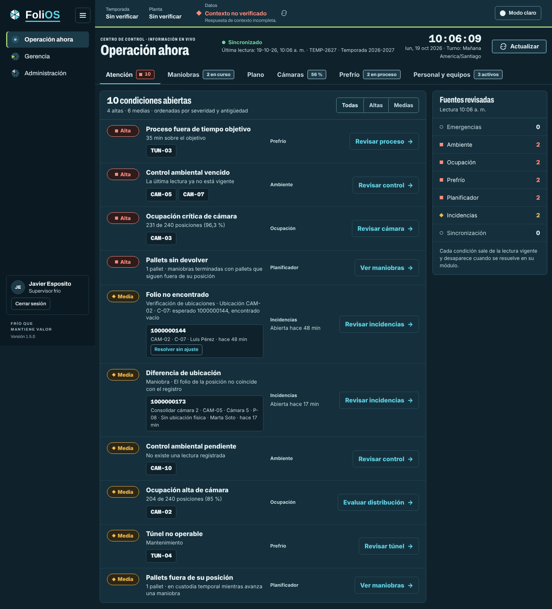
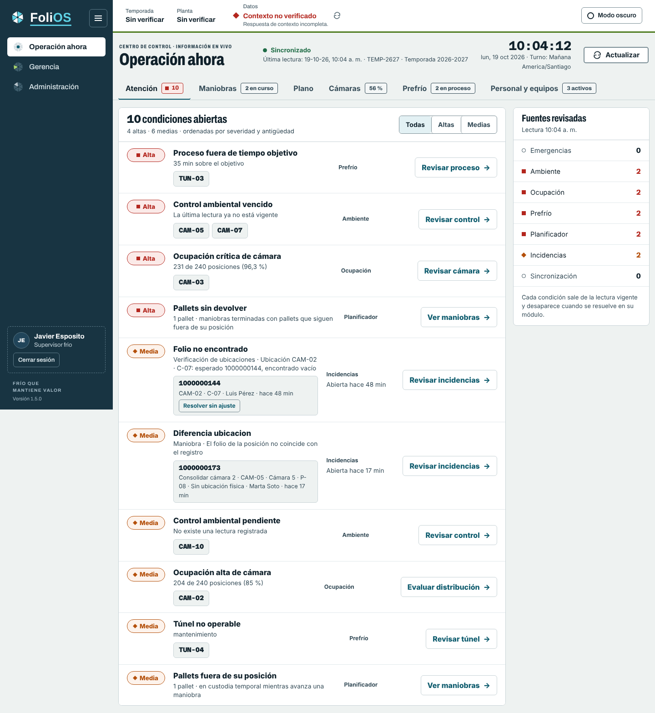
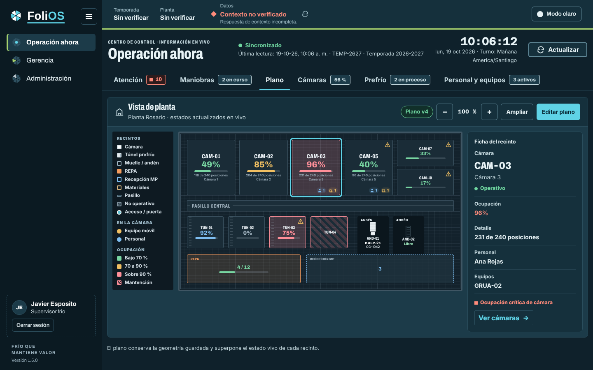
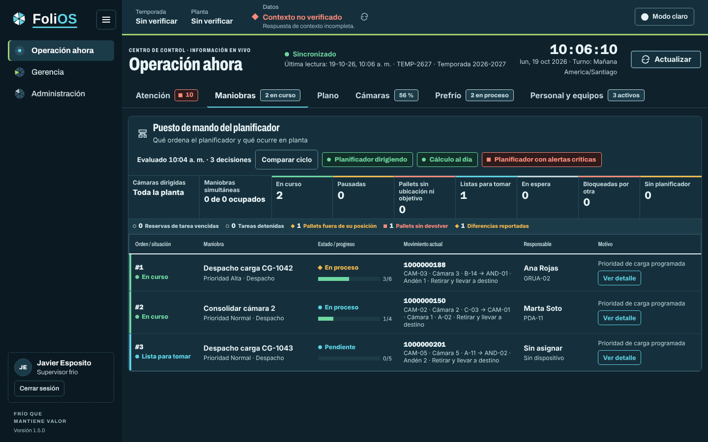
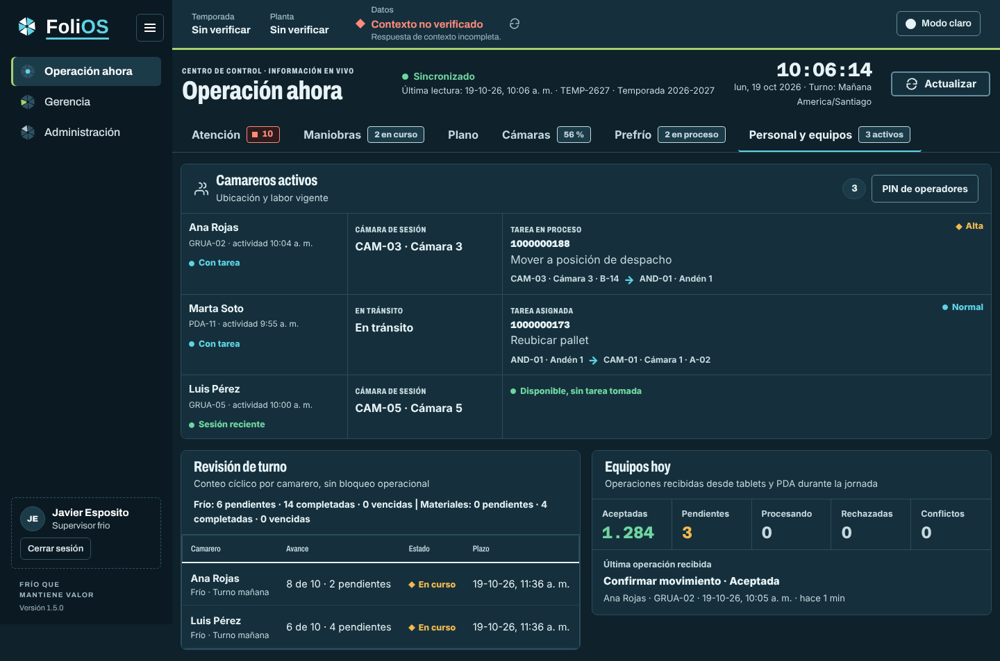
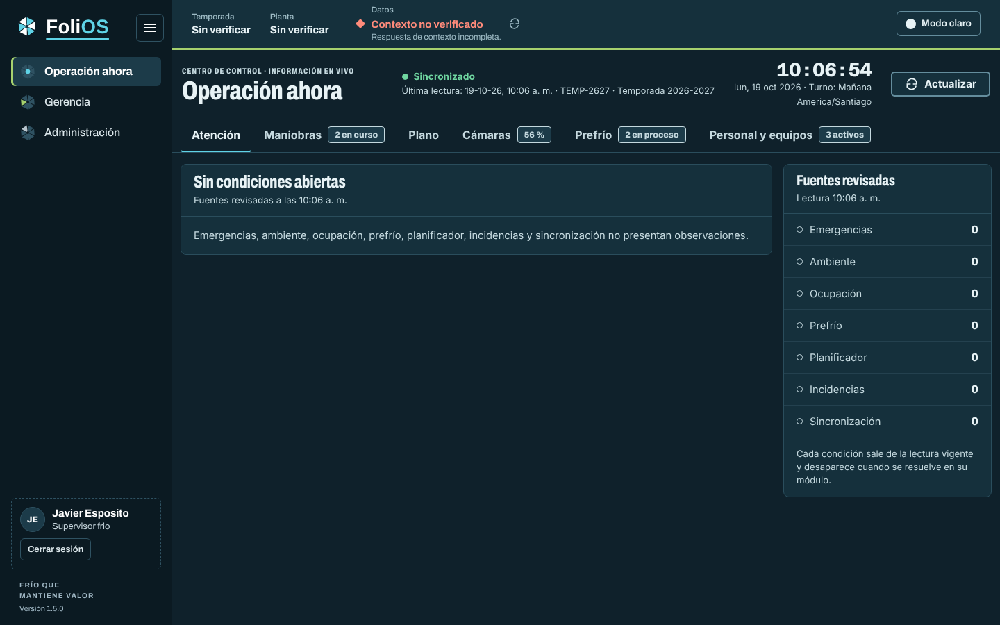

# Operación ahora en pestañas

Revisión del centro de control de Oficina (`resources/views/office/operation-now.blade.php`).
La pantalla era una tira de ocho paneles que había que recorrer: el planificador, el plano, los
camareros, las cámaras, el prefrío, las alertas, las incidencias y los accesos rápidos competían
en el mismo scroll. Al bajar se perdía el foco y lo que se estaba mirando quedaba entre otras
vistas. El plano, que es grande, quedaba comprimido entre paneles.

La idea rectora: **una pestaña por pregunta de supervisión**.

| Pestaña | Pregunta | Contenido |
|---|---|---|
| Atención | ¿Qué exige mirar ahora? | Lista única de condiciones abiertas y fuentes revisadas |
| Maniobras | ¿Qué ordena el planificador? | Puesto de mando del planificador, riesgos y decisiones |
| Plano | ¿Cómo está la planta? | Plano a todo el ancho con ficha del recinto elegido |
| Cámaras | ¿Cómo están las cámaras PT? | Ocupación, temperatura y control ambiental |
| Prefrío | ¿Cómo van los túneles? | Estado, avance contra objetivo y producto |
| Personal y equipos | ¿Quién trabaja y con qué? | Camareros, revisión de turno, sincronización y PIN |

## Decisiones

1. **La pestaña vive en la dirección** (`/oficina/operacion-ahora#plano`) para compartirla o
   volver a ella, y se recuerda en el equipo: sin pestaña en la dirección se abre la última
   vista usada; la primera vez, Atención. Cambiar de pestaña reemplaza la dirección sin llenar
   el historial.
2. **Una alerta nueva nunca cambia la pestaña.** El refresco recalcula la lista y las insignias;
   la vista visible solo cambia por la persona (clic, teclado, enlace o dirección).
3. **Insignias.** Solo Atención lleva severidad (cuadrado crítico, rombo advertencia y el
   número). Las demás dan contexto neutro («2 en curso», «56 %», «3 activos») y desaparecen en
   cero para no competir con lo que sí exige mirar.
4. **Atención agrupa por causa.** Reúne las alertas operacionales (`operation-now-alerts.js`),
   los riesgos físicos del planificador y las incidencias abiertas en
   `shared/operation-now-attention.js`. Tres cámaras con el control vencido son una fila con
   tres cámaras; las incidencias del mismo tipo, una fila con sus folios (y sus acciones:
   *Resolver sin ajuste*, *Revisar ajuste*). Orden: severidad, antigüedad y fuente. Las
   discrepancias abiertas del planificador no se repiten: ya figuran como incidencias de
   maniobra. Filtro *Todas · Altas · Medias*. Sin condiciones, una sola línea.
5. **Fuentes revisadas.** Al lado de la lista, las siete fuentes con su conteo: también se ve
   lo que está en cero, que es la evidencia de que se revisó.
6. **Plano con ficha.** El plano ocupa el ancho; al elegir un recinto (clic o teclado) la ficha
   muestra estado, ocupación, detalle, personal, equipos y sus condiciones abiertas, tomadas de
   la misma lista de Atención para no contradecirla.
7. **Encabezado compacto.** Identidad, estado de los datos, reloj y *Actualizar*. La
   sincronización de dispositivos pasa a *Personal y equipos* («Equipos hoy») con la edad de la
   última operación recibida; los conteos en cero quedan neutros.
8. **Sin accesos rápidos.** Cada fila de Atención y cada panel enlazan al módulo donde se
   resuelve; la barra de accesos repetía el menú.
9. **Formas de estado.** Círculo normal, rombo advertencia y cuadrado crítico también en las
   señales de tablas y chips del planificador. La salud del planificador se lee como «Sin
   advertencias del planificador», no como «Sin alertas», para no contradecir Atención.

## Qué no cambia

Contrato de `/api/operacion-ahora`, refresco por sondeo, diálogo de supervisión de maniobras,
comparación y replay de ciclos, editor del plano, PIN de operadores y resolución de
incidencias de verificación. Al imprimir se ven todas las pestañas una tras otra.

## Capturas

| Atención | Atención (claro) |
|---|---|
|  |  |

| Plano con ficha | Maniobras |
|---|---|
|  |  |

| Personal y equipos | Sin condiciones abiertas |
|---|---|
|  |  |

Las capturas usan datos de ejemplo; el aviso «Contexto no verificado» del encabezado de Oficina
se debe a que el entorno de captura no entrega el contexto de temporada.
