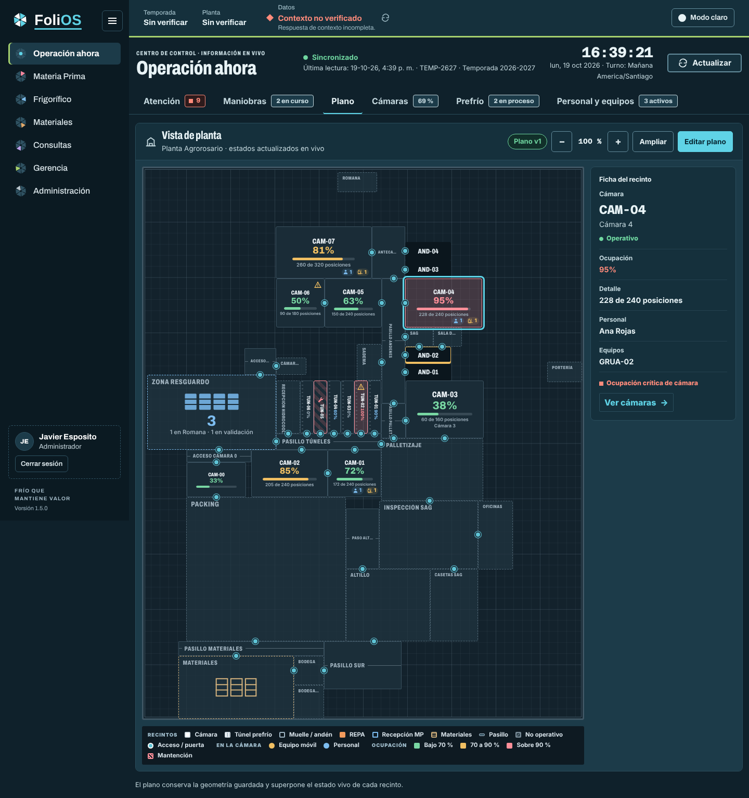
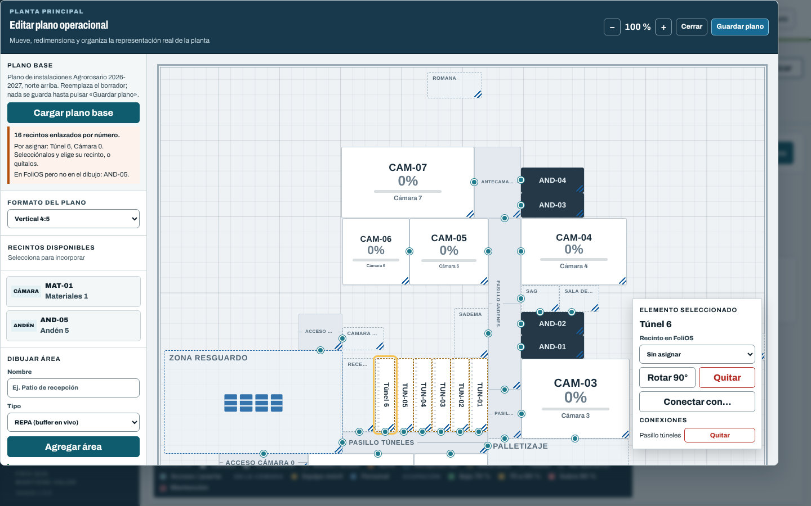
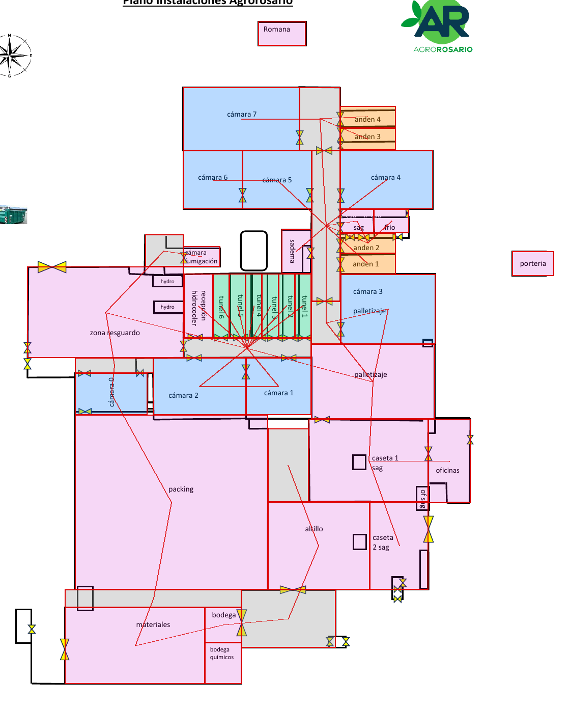

# Plano real de la planta en Operación ahora

La pestaña *Plano* dibujaba la planta con una distribución automática o con lo que el
administrador armara a mano en el editor. Este cambio trae el plano de instalaciones de
Agrorosario 2026-2027 (`PLANOS_Y_FLUJOS_EMPRESA_26-27.pdf`) como **plano base** del editor y
permite que el dibujo conserve la forma real de la planta.

## Qué cambia

1. **Proporción del plano.** Las coordenadas del plano van de 0 a 10000 en cada eje y se
   dibujaban siempre en 16:9. La planta es más alta que ancha (4:5), así que se veía estirada a
   lo ancho más del doble. El plano guarda ahora su proporción (`planos_planta.proporcion`,
   ancho/alto entre 0,5 y 2,5; sin valor sigue en 16:9) y la vista, la ampliación y el editor la
   respetan. En el editor se elige en *Formato del plano*.
2. **Plano base.** En *Editar plano* aparece *Cargar plano base*. Reemplaza el borrador con los
   44 elementos del dibujo y sus 43 conexiones (las puertas amarillas y las aberturas sin muro) y
   enlaza cada cámara, túnel y andén con el recinto de FoliOS que tenga su número (`CAM-07`,
   «Cámara 7», `T7`…). Una cámara de materiales con el mismo número no reemplaza a la de
   producto, y si dos recintos tienen el mismo número no se adivina. Nada se guarda hasta pulsar
   *Guardar plano*, con el control de versión de siempre.
3. **Recintos por asignar.** Lo que el plano base no pudo enlazar queda marcado. Al
   seleccionarlo, el inspector muestra *Recinto en FoliOS* para elegirlo sin perder forma ni
   conexiones. El editor no guarda mientras quede un recinto sin asignar. Esto también sirve
   para reasignar cualquier recinto.
4. **Recintos angostos legibles.** Los túneles y andenes son franjas delgadas. El relleno de
   cada recinto se ajusta a su tamaño y, cuando es angosto y alto, el código va vertical, como en
   el plano impreso. Si es bajo, queda solo el código. Los andenes ocupados marcan el borde. El
   zoom llega a 300 %.
5. **Pestaña Plano.** El plano ocupa el ancho junto a la ficha del recinto, que queda fija al
   recorrer el plano, y la leyenda pasa debajo.
6. **Editor con el tema.** El panel lateral, el inspector y los formularios del editor usan
   las superficies del tema de Oficina y se leen en claro y en oscuro.

## Cómo se trasladó el dibujo

El PDF trae el dibujo vectorial de Excel. Se tomaron de él los rectángulos de cada recinto,
los muros y los símbolos de puerta en puntos, y se llevaron a 0..10000 con un marco de 505 × 631
pt (proporción 4:5) que incluye la romana y la portería. Ajustes deliberados:

- Los seis túneles quedan del mismo ancho (en el dibujo varían entre 11 y 20 pt).
- Los andenes tienen el alto mínimo editable, de 300 unidades; el bloque SAG/sala de frío cede
  un poco de alto para que quepan.
- Las áreas en L se dividen en rectángulos: pasillo de andenes y pasillo de palletizaje,
  inspección SAG y casetas SAG, altillo y paso del altillo.
- Los equipos *hydro*, el contenedor y los objetos sueltos del dibujo no se trasladan.

Áreas confirmadas: la **zona de resguardo** lleva el indicador en vivo de **Recepción MP**.
**Palletizaje no es REPA** (repaletizaje): queda como área de packing. Si el buffer de
repaletizaje tiene un lugar físico, se dibuja en el editor como área REPA. «Frío», «sadema»,
las casetas y el altillo quedan como áreas sin indicador.

El plano base está en `resources/js/shared/plant-templates.js`. Su prueba
(`tests/JavaScript/plant-templates.test.mjs`) verifica tamaños, límites, superposiciones y que
cada conexión comparta un borde, con las mismas reglas del servidor.

## Capturas

| Pestaña Plano (datos de ejemplo) | Editor con el plano base cargado |
|---|---|
|  |  |

