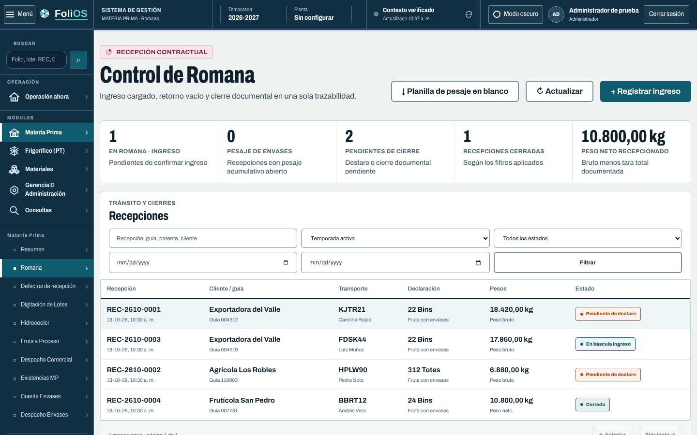
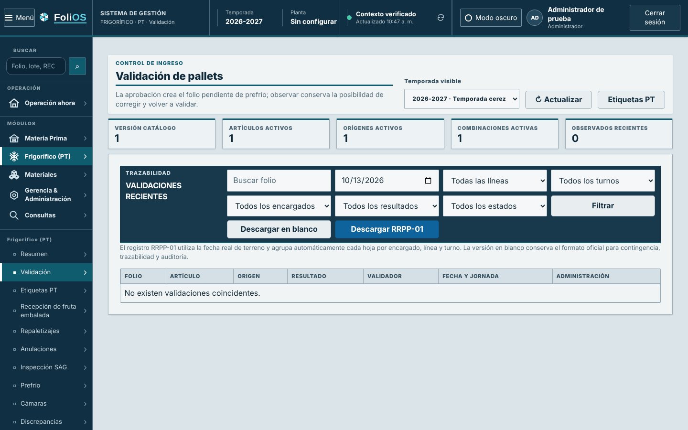
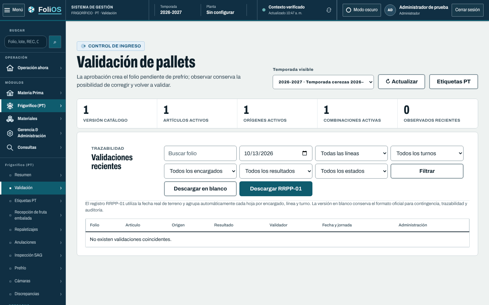
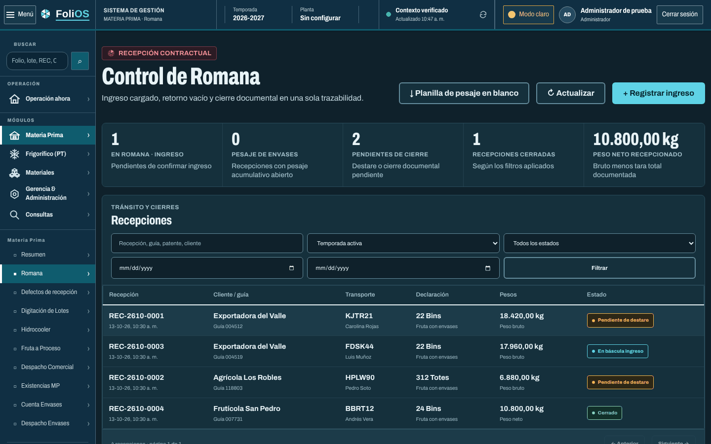

# PR 1 · Fundaciones FoliOS v2

**Rama:** `diseno/pr1-fundaciones` · **Base:** `main` (a8c335e7) · **Entrega:** parche `0001`
**Título del PR:** `feat(diseno): fundaciones FoliOS v2 (tokens, fuentes y capa transversal de Oficina)`

## Qué cambia para el usuario

Las 34 oficinas cambian de golpe al lenguaje de etiqueta: papel `#EEF2F1`, tarjetas blancas
de radio 8, títulos en Archivo angosta, cifras grandes, tablas sin líneas verticales, un solo
color de acción (frost) y la etiqueta del área sobre cada título. El shell (menú y cabecera)
todavía es el anterior: lo cambia el PR 2.

| Antes | Después de este PR |
|---|---|
|  |  |
|  |  |

Modo oscuro: 

## Archivos

| Archivo | Cambio |
|---|---|
| `design/estiba.tokens.json` | Tokens v2 completos (ver README § 1). Grupos nuevos: `area`, `areaDark`, `fontStretch`; claves nuevas en `color`/`colorDark`. `manifest` y `density` sin cambios. |
| `scripts/build-design-tokens.mjs` | `DARK_KEYS` incluye `areaDark: 'area'`. |
| `resources/css/estiba-tokens.css`, `mobile/src/theme/estibaTokens.ts` | Regenerados con `npm run design:tokens`. No editar a mano. |
| `package.json`, `package-lock.json` | Dependencias `@fontsource-variable/archivo@^5.3.0` y `@fontsource-variable/azeret-mono@^5.3.0`. |
| `resources/css/folios-fonts.css` (nuevo) | Importa `archivo/standard.css` (peso + ancho) y `azeret-mono/wght.css`. |
| `resources/css/office-corporate.css` | Solo los dos bloques vigentes `:root[data-office-theme="light-professional"]` y `…="dark-industrial"` (sección “Temas operacionales ESTIBA”) con valores v2 + variables nuevas (`--primary`, `--seal`, `--line-soft`, `--input-border`, `--font-*`, `--radius-*`, `--area-*`). El resto del archivo no se toca. |
| `resources/css/office-folios.css` (nuevo) | Capa final transversal: tipografía, área activa (`:root:has([data-active-domain=…])`), tarjetas, encabezado de página con etiqueta de área, indicadores en celdas, tablas, campos, botones, sellos, foco y diálogos. |
| `resources/views/components/office/navigation.blade.php` | `@vite` agrega `resources/css/office-folios.css` después de `office-shell.css`. |
| `vite.config.js` | Entrada `resources/css/office-folios.css`. |
| `resources/css/estiba-ui.css` | Fuente base y `.eui-code` desde tokens (`--eui-font-family-sans/mono`). |
| `resources/css/office-cameras.css`, `office-load-status.css`, `office-loads.css` | Pilas monoespaciadas → `var(--font-mono, ui-monospace, Consolas, monospace)`. |
| `tests/JavaScript/DesignTokensTest.mjs` | `frost ≠ primary` pasa a `frost = primary` (decisión v2) + pruebas de áreas, sello y crítico. |
| `tests/JavaScript/FoliosV2FoundationTest.mjs` (nuevo) | Temas de Oficina = tokens; carga de la capa y fuentes; reglas de las 7 áreas. |
| `docs/diseno/folios-v2/**` (nuevo) | Este sistema, láminas, HTML de referencia, capturas y especificaciones de la serie. |

## Decisiones que no se reinterpretan

1. Los valores de color salen **solo** de `design/estiba.tokens.json` y de los dos bloques de
   tema de `office-corporate.css`. `FoliosV2FoundationTest` falla si divergen.
2. `office-folios.css` se carga **al final**. No mover sus reglas a `office-corporate.css`
   (ese archivo resuelve su cascada por orden de aparición y `OfficeThemeContrastTest` lee la
   última aparición de cada bloque de tema).
3. Los botones usan `:is(button, a).primary-button` para igualar la especificidad de las
   reglas heredadas `.office-app button.primary-button`; sin eso, en oscuro el texto queda
   blanco sobre frost claro.
4. El color del área se resuelve con `:has()` sobre `data-active-domain`/`data-active-office`
   del shell. No agregar JavaScript para esto.
5. El eyebrow del encabezado de página conserva su texto actual (en mayúsculas); solo cambia
   su forma a etiqueta de área.
6. La exportación del catálogo (`ui:catalogo`) no lleva fuentes web: por eso
   `estiba-ui.css` no importa `folios-fonts.css`.

## Cómo aplicar

```bash
git switch -c diseno/pr1-fundaciones origin/main
git am --keep-cr parches/0001-*.patch
npm ci && npm run design:check && npm run test:js && npm run build
php artisan test
```

## Criterios de aceptación

- [ ] `npm run design:check` sin diferencias; `npm run test:js` verde (181 pruebas a la fecha).
- [ ] `php artisan test` verde (1143 pruebas a la fecha, MySQL 8).
- [ ] En `/oficina/romana` y `/oficina/validacion` la vista coincide con las capturas `pr01-*`.
- [ ] El texto de la página usa “Archivo Variable” (DevTools → Computed → Rendered fonts) y los
      códigos de Cámaras/Cargas usan “Azeret Mono Variable”.
- [ ] Modo oscuro: botón “+ Registrar ingreso” con texto `#062530` sobre `#5FD3E6`.
- [ ] Ninguna llamada a `fonts.googleapis.com` en la red.
