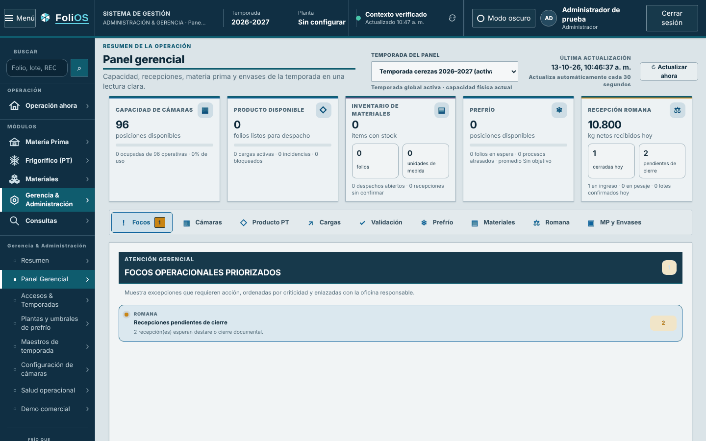
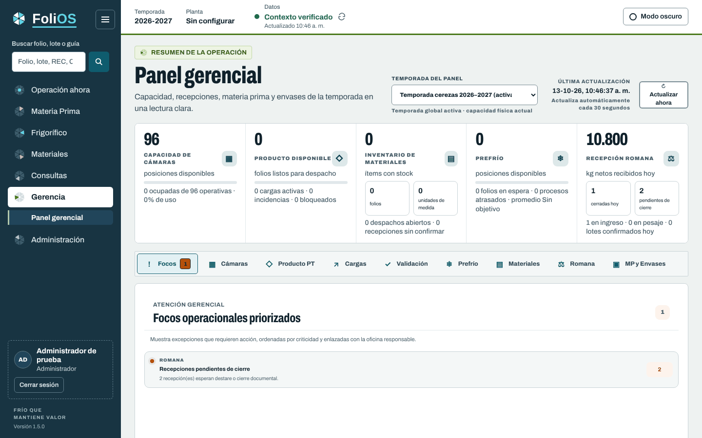

# PR 2 · Shell de Oficina por áreas

**Rama:** `diseno/pr2-shell` · **Base:** PR 1 · **Entrega:** parche `0002`
**Título del PR:** `feat(oficina): shell FoliOS v2 por áreas del gajo`

## Qué cambia para el usuario

- Menú lateral navy de 248 px con el logo arriba, la búsqueda, **Operación ahora** (centro del
  gajo) y las **seis áreas** con su hoja de color. Gerencia se separa de Administración.
- Las oficinas del área activa aparecen anidadas bajo el área; la oficina abierta lleva una
  marca de 3 px del color del área.
- Barra de contexto blanca: Temporada, Planta, Datos (estado del contexto, se puede
  actualizar), rótulo de servidor opcional y Modo oscuro. Regla inferior de 3 px del área.
- Usuario, rol y Cerrar sesión pasan al pie del menú, con la firma “Frío que mantiene valor”.

| Antes | Después (PR 1–3) |
|---|---|
|  |  |

Otras: `capturas/pr04-materia-prima_lotes.png`, `capturas/pr04-operacion-ahora.png`,
`capturas/pr04-oscuro-materiales_recepciones.png`. Lámina: `laminas/04-romana.png` (columna
izquierda y barra superior).

## Archivos

| Archivo | Cambio |
|---|---|
| `resources/views/components/office/navigation.blade.php` | Dominio `gerencia` (oficinas `panel` y `operacion-ahora`); `administracion` pierde esas dos. Etiquetas de área: Materia Prima, Frigorífico, Materiales, Consultas, Gerencia, Administración (en ese orden). Compatibilidad: `domain="administracion"` con `office="panel"` u `"operacion-ahora"` se muestra como Gerencia. Marcado nuevo del shell (ver abajo). |
| `resources/views/components/folios/gajo.blade.php` (nuevo) | `<x-folios.gajo :area :size :label>`. |
| `resources/css/office-shell.css` | Reescrito completo. |
| `resources/css/office-folios.css` | Se elimina el bloque provisional `.estiba-office-shell { font-stretch: 85% }` del PR 1. |
| `resources/views/office/management.blade.php`, `operation-now.blade.php` | `domain="gerencia"`. |
| `config/app.php`, `.env.example` | `app.server_label` ← `FOLIOS_SERVER_LABEL` (vacío = no se muestra). |
| Pruebas | `EstructuraOficinaTest` (6 áreas), `OfficeLayoutTest` (248 px), `InterfazEliminacionCatalogoValidacionTest` (rótulo de Administración), nuevas `ShellFoliosV2Test.php` y `FoliosV2ShellTest.mjs`. |

### Contratos que se conservan (no cambiar)

`data-office-shell`, `data-office-shell-header` con `data-active-domain` y `data-active-office`,
`data-office-menu`, `data-office-menu-label`, `data-office-home`, `data-office-season`,
`data-office-plant`, `data-office-context-refresh/-label/-status`, `data-office-theme-toggle`,
`data-office-theme-label`, `#officeInitials`, `#officeUserName`, `#officeUserRole`,
`data-office-readonly`, `#officeLogoutButton`, `data-office-notices`, `#officeSidebar`,
`#officeGlobalSearch` y su formulario, `data-office-key`, `data-office-domain`,
`data-navigation-permissions`, `data-navigation-module`, `data-domain-key`,
`data-navigation-targets`, enlaces heredados `office*Nav`, `data-material-replenishment-indicator`.
`office-navigation.js` y `office-shell.js` **no se modifican**.

### Estructura del marcado

```
div.estiba-ui.estiba-office-shell[data-office-shell][data-folios-area=<área>]
  a.estiba-office-skip
  header.estiba-office-header[data-office-shell-header]
    div.estiba-office-brand            (navy: logo + botón Menú 40×40, rótulo solo para lectores)
    div.estiba-office-system.estiba-office-sr   (“SISTEMA DE GESTIÓN · contexto · oficina”, oculto)
    div.estiba-office-context          (Temporada, Planta)
    button.estiba-office-status        (Datos: punto de tono, rótulo, detalle, ícono refresh)
    div.estiba-office-tools            (span.estiba-office-server opcional, botón modo oscuro)
    a.estiba-office-replenishment      (solo Materiales; fila completa bajo la barra)
  div.estiba-office-notices
  aside#officeSidebar.estiba-office-sidebar
    form.estiba-office-search
    nav.estiba-office-primary          (Operación ahora con gajo centro)
    nav.estiba-office-areas            (6 a.estiba-office-domain con gajo; bajo la activa:)
      nav.estiba-office-offices        (oficinas del área, subgrupos “Despacho”)
    div.estiba-office-identity         (avatar, nombre, rol, “Solo consulta”, Cerrar sesión)
    div.estiba-office-signature
```

### Medidas

| Elemento | Valor |
|---|---|
| Ancho del menú | 248 px (224 px entre 1200 y 1399 px; 0 bajo 1200 px, cajón de hasta 320 px) |
| Alto de la barra | 72 px mínimo (lo mide `office-shell.js` en `--office-header-height`) |
| Ítem de área | 42 px, radio 6, 16 px/500, gajo 24 px; activo fondo blanco, texto Tinta, 700 |
| Oficina | 14.5 px/500 `#C5D4DB`, sangría 48 px; activa fondo `#21455A`, marca 3 px `--area-bright` |
| Búsqueda | Campo blanco de 42 px en Azeret Mono 14 px + botón frost 42×42 |
| Contexto | Rótulo 12 px Rótulo; valor 15 px/700 Tinta; “Datos” en éxito/crítico según tono |
| Modo oscuro | Botón secundario de 36 px; bajo 1400 px solo ícono |
| Oscuro | Menú `#0B1A22`, hover `#1C3B49`, área activa sin fondo blanco: `#1C3B49` + marca 3 px |

“Turno” aparece en las láminas pero el contexto de Oficina (`/api/oficina/contexto`) no lo
entrega: **no se agrega** en este PR.

## Cómo aplicar

```bash
git switch -c diseno/pr2-shell diseno/pr1-fundaciones
git am --keep-cr parches/0002-*.patch
npm run test:js && npm run build && php artisan test
```

## Criterios de aceptación

- [ ] 6 `[data-domain-key]` en todas las oficinas, en el orden indicado; 1 `aria-current="page"`.
- [ ] `/oficina/gerencia` y `/oficina/operacion-ahora` marcan Gerencia y Operación ahora;
      `/oficina/accesos` sigue en Administración sin “Panel gerencial”.
- [ ] Sin desplazamiento horizontal a 1280 px en Romana, Validación, Cámaras, Gerencia e
      Inventario CC. (Recepciones de materiales ya desbordaba 22 px en `main`; lo corrige el PR 6.)
- [ ] Menú oculto (botón Menú) recuerda la preferencia y el logo sigue visible.
- [ ] Con `FOLIOS_SERVER_LABEL="Servidor oficial"` aparece el rótulo; vacío, no.
