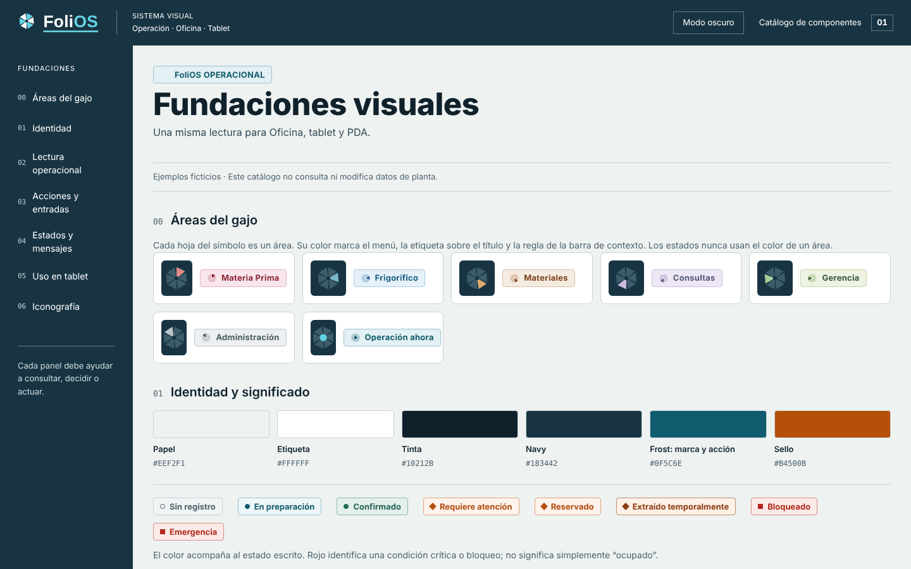

# PR 3 · Componentes x-estiba v2, etiqueta de área y catálogo

**Rama:** `diseno/pr3-componentes` · **Base:** PR 2 · **Entrega:** parche `0003`
**Título del PR:** `feat(diseno): componentes x-estiba v2, etiqueta de área y catálogo`

## Qué cambia

Las pantallas construidas con `<x-estiba.*>` (Discrepancias, partes de Operación ahora y
Cámaras) adoptan el mismo lenguaje que el resto de Oficina, y el catálogo visual muestra las
áreas del gajo.



Discrepancias con PR 1–3: `capturas/pr04-frigorifico_discrepancias.png`.

## Archivos

| Archivo | Cambio |
|---|---|
| `resources/css/folios-components.css` (nuevo) | Gajo (movido desde `office-shell.css`) y `.folios-area-tag` con sus 7 áreas. Lo importa `office-folios.css`. |
| `resources/views/components/folios/area-tag.blade.php` (nuevo) | `<x-folios.area-tag area="…">Texto</x-folios.area-tag>`; área desconocida → `operacion`. |
| `resources/css/estiba-ui.css` | `.eui-heading` sin regla frost; eyebrow = etiqueta de área (`--area-*`, con respaldo `--eui-area-operacion-*`); título masthead 800/66 %; panel con cabecera de 1 px y título 26 px/800/72 %; botón 2 px, radio 6, 700; sello con borde 1.5 px y radio 4; tabla sin verticales, encabezado 12 px/600 con regla de 2 px en Tinta; campo 1.5 px; métrica 22 px/800/70 %; medidor redondeado. |
| `resources/css/office-folios.css` | Importa `folios-components.css`; deja de forzar ancho angosto sobre `.estiba-ui` (lo define ahora `estiba-ui.css`). |
| `resources/css/office-shell.css` | Sin la sección Gajo (vive en `folios-components.css`). |
| `app/Console/Commands/ExportarCatalogoVisual.php` | Incorpora `folios-components.css` en línea. |
| `resources/views/design/catalog.blade.php`, `resources/css/estiba-catalog.css` | Sección “Áreas del gajo” y muestrario Papel/Etiqueta/Tinta/Navy/Frost/Sello. |
| Pruebas | `FoliosV2ComponentsTest.mjs`, `FoliosAreaTagTest.php`; `FoliosV2ShellTest.mjs` lee el gajo desde `folios-components.css`. |

## Decisiones que no se reinterpretan

- La API de los componentes no cambia (`heading`, `panel`, `signal`, `metric`, `button`,
  `code`, `table`). Solo cambia su CSS.
- Las formas de los sellos se conservan: éxito/info círculo, atención/reservado/temporal
  rombo, crítico/bloqueado cuadrado, neutro círculo hueco.
- Cámaras tiene cabeceras propias (`office-cameras.css`, navy con `data-estiba-contrast`):
  **no** se tocan aquí; quedan para su propio PR cuando exista lámina.

## Cómo aplicar

```bash
git switch -c diseno/pr3-componentes diseno/pr2-shell
git am --keep-cr parches/0003-*.patch
npm run test:js && npm run build && php artisan test && php artisan ui:catalogo
```

## Criterios de aceptación

- [ ] `php artisan test` verde (1150 a la fecha con PR 1–3).
- [ ] El catálogo exportado tiene 7 `data-catalog-area` y ningún `@import`.
- [ ] Discrepancias: etiqueta de área “Supervisión operacional” con gajo de Frigorífico y título
      sin mayúsculas forzadas.
