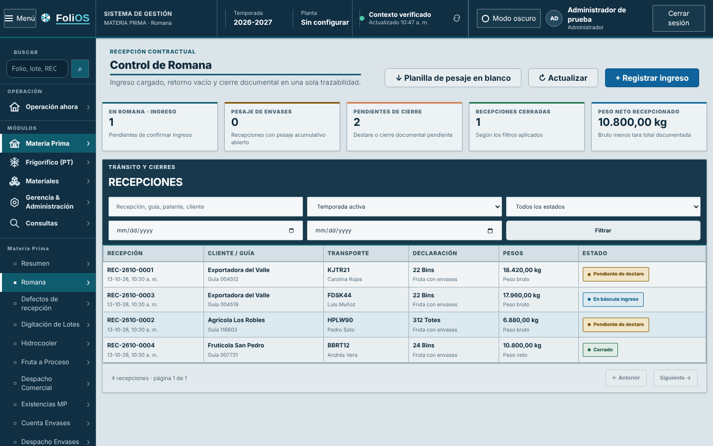
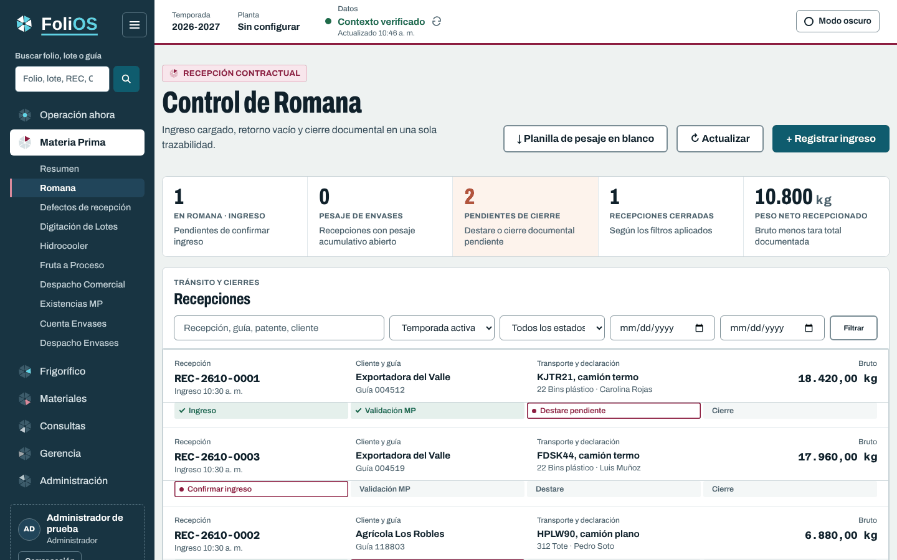

# PR 4 · Romana

**Rama:** `diseno/pr4-romana` · **Base:** PR 3 · **Entrega:** parche `0004`
**Título del PR:** `feat(romana): lista de recepciones y expediente FoliOS v2`
**Lámina:** `laminas/04-romana.png` · `html/04-romana.html`

## Qué cambia para el usuario

- Cada recepción es una fila de etiqueta: código en Azeret Mono, cliente y guía, transporte y
  declaración, y el peso a la derecha.
- Bajo cada recepción, su **avance en pasos** (hecho ✓, ahora ●, después) con el texto de lo
  que falta: “Confirmar ingreso”, “Validación MP en curso”, “Destare pendiente”, “Pesaje de
  envases 3/5”, “Listo para cerrar”, “Cerrada”.
- “Pendientes de cierre” se marca con sello cuando hay casos; el neto del día se muestra sin
  decimales, con “kg” menor.
- El expediente lateral (ya existente) adopta la etiqueta: código grande en Azeret, hechos en
  filas, balance con guiones, acciones al pie. Ancho 360–460 px.

| Antes | Después |
|---|---|
|  |  |

Expediente: `capturas/pr04-romana-expediente.png` · Oscuro:
`capturas/pr04-oscuro-romana.png`, `capturas/pr04-oscuro-romana-expediente.png`.

## Archivos

| Archivo | Cambio |
|---|---|
| `resources/js/shared/weighbridge-steps.js` (nuevo) | `receptionSteps(recepcion)` → `[{ label, state: 'done'|'now'|'next' }]`. |
| `resources/js/office-weighbridge.js` | Importa `receptionSteps`; nuevas `receptionTrack`, `formatTime`, `formatKpiWeight`; `renderList` con dos filas por recepción (`tr.rec-row` + `tr.rec-track`, ambas con `data-reception-id`); vacío con `colspan="4"`; marca `.has-attention` en el indicador de cierre. |
| `resources/views/office/weighbridge.blade.php` | Encabezado de tabla de 4 columnas con `scope="col"` (queda oculto a la vista, visible para lectores); `data-weighbridge-attention="exit"` en el indicador. |
| `resources/css/office-weighbridge.css` | Sección “FoliOS v2 · Romana”. |
| `resources/css/office-weighbridge-drawer.css` | Sección “FoliOS v2 · expediente de recepción”. |
| Pruebas | `WeighbridgeStepsTest.mjs` (todas las combinaciones de estado), `InterfazOficinaRomanaTest` (marcado). |

## Reglas del avance (no reinterpretar)

| Tipo de recepción | Pasos |
|---|---|
| Fruta con envases | Ingreso → Validación MP → Destare → Cierre |
| Fruta con pesaje acumulativo (`pesaje_envases`) | Ingreso → Pesaje de envases → Cierre |
| Solo envases | Ingreso documental → Cierre |

- `en_bascula_ingreso`: paso 1 ahora, texto “Confirmar ingreso”.
- Fruta con envases tras confirmar: Validación MP ahora (“Validación MP pendiente” o “… en
  curso”) hasta `estado_validacion_mp = validada`; luego “Destare pendiente”.
- `cerrado`: todos hechos; el último dice “Cerrada”.
- Solo envases en `en_bascula_salida`: “Listo para cerrar”.

## Medidas

| Elemento | Valor |
|---|---|
| Fila | Relleno 14/18 px; rótulo 12 px; valor 15 px/700; detalle 13 px |
| Código y peso | Azeret Mono 17 px/700, −0.03em |
| Paso | 26 px de alto, radio 3, 12.5 px/600; hecho `--success-bg/--success-text`; ahora blanco con contorno 1.5 px `--area-ink` y texto `--area-text`; después `--surface-muted/--text-subtle` |
| Fila seleccionada | Fondo `--area-tint`, marca izquierda 3 px `--area-ink` en ambas filas |
| Indicador en atención | Fondo `--seal-bg`, cifra `--seal` |
| Filtros | Una fila de 6 columnas ≥ 1400 px; dos filas bajo 1400 px o con el expediente abierto |
| Expediente | Código 26 px Azeret; hechos en filas 13/14 px; balance con guiones; botón principal 50 px ancho completo |

## Fuera de alcance

Los chips de filtro de la lámina (“Todas / En báscula / …”) **no** reemplazan al formulario de
filtros: se mantienen búsqueda, temporada, estado y fechas. La línea de tiempo y el balance
siguen en las pestañas del expediente existente.

## Cómo aplicar

```bash
git switch -c diseno/pr4-romana diseno/pr3-componentes
git am --keep-cr parches/0004-*.patch
npm run test:js && npm run build && php artisan test
```

## Criterios de aceptación

- [ ] Con recepciones en los cuatro estados, la lista coincide con `capturas/pr04-romana.png`.
- [ ] Clic o Enter en cualquiera de las dos filas abre el expediente y ambas quedan marcadas.
- [ ] A 1280 px sin desplazamiento horizontal, con y sin expediente abierto.
- [ ] Lector de pantalla: el avance se anuncia como lista con “hecho / en curso / pendiente”.
