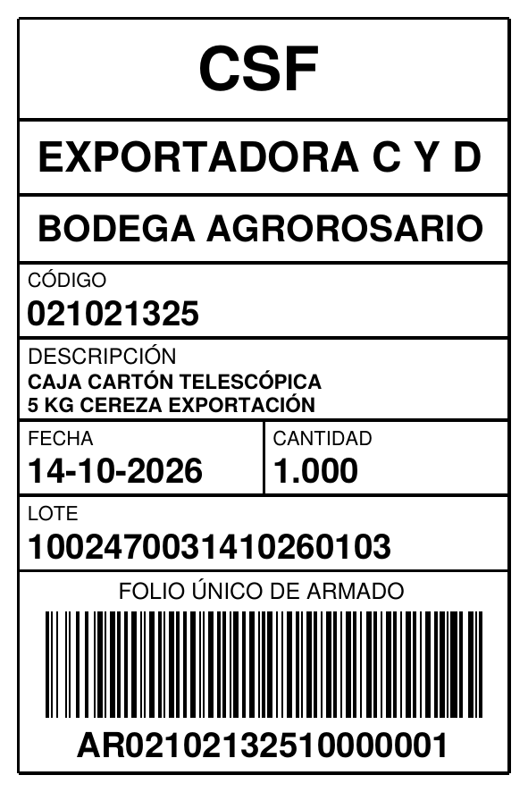
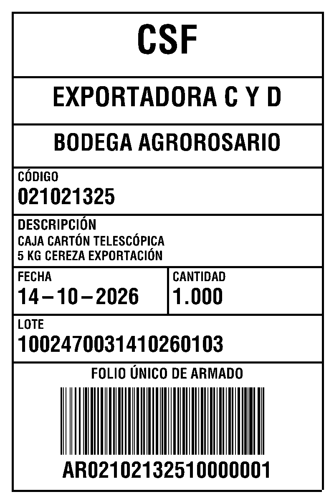
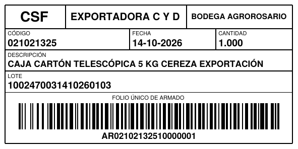
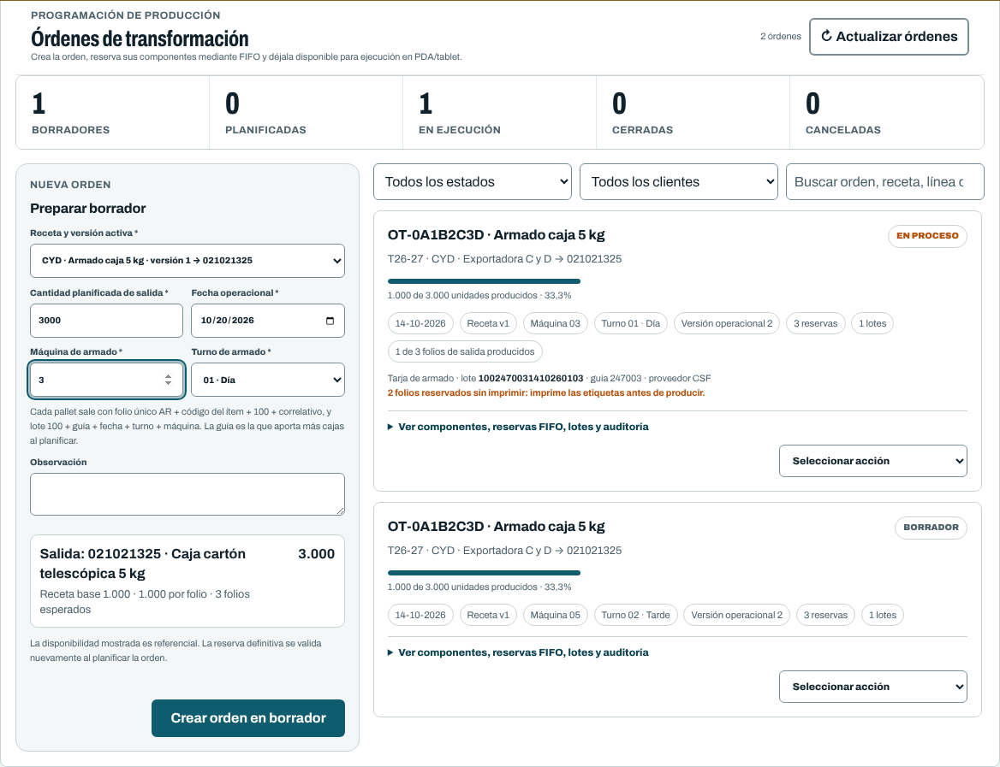

# Tarja de armado

Bodega pidió que cada pallet de cajas armadas salga con su **tarja de armado**: proveedor de
la caja, cliente dueño, bodega de armado, código y descripción del ítem, fecha del armado,
cajas del pallet, lote y un **folio único de armado**. Ese folio es el folio del pallet en
FoliOS: la PDA lo escanea igual que cualquier folio de materiales.

## Qué lleva

| Campo | De dónde sale | Ejemplo |
|---|---|---|
| Proveedor | Código del proveedor de la guía principal (si no tiene código, su nombre) | `CSF` |
| Cliente | Nombre del cliente de la orden | `EXPORTADORA C Y D` |
| Bodega | `MATERIALES_ARMADO_NOMBRE_BODEGA` | `BODEGA AGROROSARIO` |
| Código | Código del ítem de salida (codificación del cliente) | `021021325` |
| Descripción | Nombre del ítem de salida | |
| Fecha | Fecha operacional de la orden: el día del armado (DD-MM-AAAA) | `14-10-2026` |
| Cantidad | Cajas del pallet (teóricas en la tarja anticipada, reales en la del pallet producido) | `1.000` |
| Lote | bodega + guía + fecha DDMMAA + turno + máquina | `100` `247003` `141026` `01` `03` |
| Folio único de armado | `AR` + código del ítem + bodega + correlativo de 5 dígitos, con Code 128 (o QR) | `AR` `021021325` `100` `00001` |

- **Guía.** La guía de recepción que aporta más cajas reservadas al componente principal de la
  orden. Si dos guías empatan, la primera por FIFO. Un folio que llegó por transferencia entre
  clientes conserva la guía de su folio de origen.
- **Turno.** `01` día, `02` tarde.
- **Máquina.** De 1 a 99; se guarda con dos dígitos (`3` → `03`).
- **Correlativo.** Uno por ítem y bodega. Nunca se repite: salta cualquier número que ya exista
  como folio o como folio reservado, y no se reutiliza al anular.

Guía, proveedor, turno, máquina y lote se fijan **al planificar** la orden y quedan en
`ordenes_transformacion_materiales.datos_armado`. Los folios reservados de la orden ya salen
con el folio de armado y, al cerrar cada lote, el pallet producido conserva ese folio, el lote
de la tarja y el proveedor de la caja.

## Cómo se activa

La tarja se enciende con el código de bodega. Sin código, todo sigue como antes: folios
`F` + cliente + 7 dígitos, lote `TR-…`, línea y turno libres.

```dotenv
MATERIALES_ARMADO_CODIGO_BODEGA=100
MATERIALES_ARMADO_NOMBRE_BODEGA="BODEGA AGROROSARIO"
```

Con la tarja activa:

- **Oficina → Materiales → Órdenes** pide *Máquina de armado* (1 a 99) y *Turno de armado*
  (01 · Día, 02 · Tarde) en vez de línea y turno libres. Cada orden muestra máquina, turno y,
  una vez planificada, el lote, la guía y el proveedor de su tarja.
- **Al planificar**, si la orden no tiene turno 01/02 o máquina válida (por ejemplo, un
  borrador creado antes de activar la tarja), la planificación se rechaza con el motivo y no
  reserva nada. Se cancela y se crea de nuevo.
- **Etiquetas.** PDF, ZPL y `.nlbl` imprimen la tarja. Se adapta al perfil: en etiqueta vertical
  o cuadrada, una fila por dato; en la de 100 × 50 apaisada, los mismos datos en cinco filas. La
  descripción larga pasa a dos líneas. En `.nlbl` las celdas van sin bordes, para ajustarlas en
  ZebraDesigner.

| PDF 100 × 150 | ZPL 100 × 150 (vista previa) | PDF 100 × 50 |
|---|---|---|
|  |  |  |



## Al desplegar

1. `git pull --ff-only origin main`
2. `php artisan migrate --force`: crea `correlativos_folio_armado_materiales` y agrega
   `datos_armado` a las órdenes (nullable).
3. En `.env`: `MATERIALES_ARMADO_CODIGO_BODEGA=100` y, si cambia,
   `MATERIALES_ARMADO_NOMBRE_BODEGA`.
4. `npm ci` y `npm run build`.
5. `php artisan optimize:clear` (o `php artisan config:clear` si la configuración está en caché).
6. En el catálogo de proveedores, el proveedor de las cajas debe tener código `CSF`: la tarja
   imprime el código del proveedor.
7. Revisar que los ítems de salida usen la codificación del cliente (por ejemplo, `021021325`):
   ese código va en el folio y en la tarja.
8. Imprimir con un perfil de 100 × 100 o 100 × 150 si el pallet lo permite; la de 100 × 50
   también sirve.
