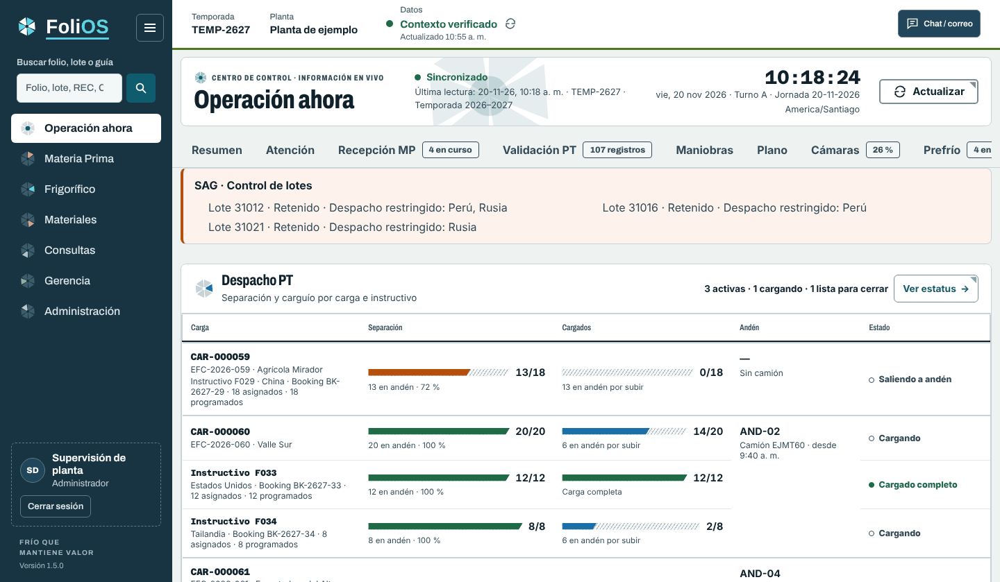
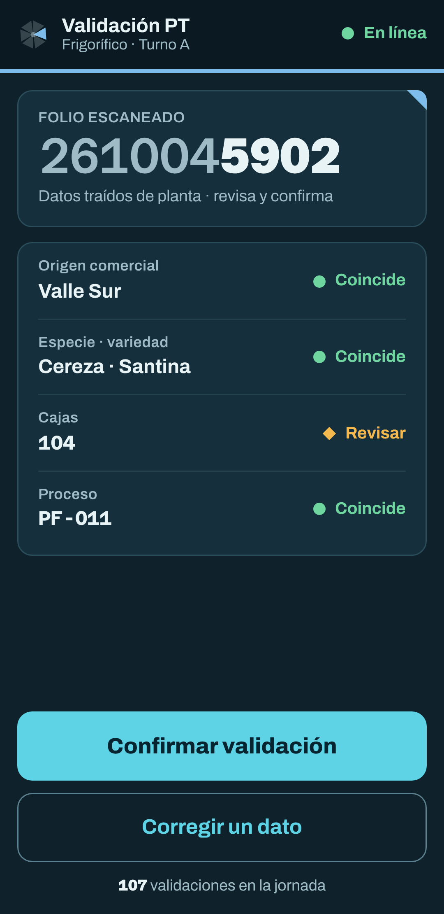

# Gajos vivos: la idea original

Este documento registra la propuesta **Gajos vivos** tal como se definió el 20-11-2026, para que sirva de referencia al comparar lo que hoy está en `main`. Describe la idea; no describe lo implementado.

- **Origen:** la propuesta salió de un chat en claude.ai. L.K.S. compartió la vista previa `FoliOS-Gajos.html`, con las pantallas Resumen de planta, Despacho PT y Gerencia · Prefrío del rediseño FoliOS v2 ([../folios-v2/README.md](../folios-v2/README.md)), y pidió mejorar «la propuesta de sistema con identidad».
- **Entregables de ese chat:** un lienzo de diseño privado en claude.ai, un HTML autocontenido de unos 2,8 MB (no se versiona por su peso) y las imágenes. Este documento, las [capturas](capturas/) y las [maquetas de referencia](referencia/) reemplazan a esos entregables dentro del repositorio.
- **Implementación posterior:** después de la propuesta, los PR #707 («Rediseño integral Gajos en Oficina y terreno») y #710 («Aplica el rediseño Gajos en Oficina y terreno») aplicaron el rediseño. No se ha revisado cuánto de esta idea quedó en ellos. Ese es el uso previsto de este documento.

## La idea en una frase

El símbolo de FoliOS deja de ser adorno y pasa a ser el instrumento con que se lee la planta. Cada hoja del gajo es un área y se llena cuando esa área tiene algo que atender.

> El color dice dónde estás; la forma dice cómo está; la celda dice cuánto falta; el gajo dice dónde mirar.

## Lo que no cambia

Estas eran las condiciones de la propuesta:

- **Logo oficial:** el gajo radial con «Foli»/«OS», sin cambios.
- **Colores:** los siete colores de área y la paleta de estados de `design/estiba.tokens.json`, con sus valores actuales. Cambia dónde aparecen, no cuáles son.
- **Tipografía:** Archivo (variable, a 66 % de ancho en los títulos) y Azeret Mono, autoalojadas.
- **Temas:** Oficina clara por defecto, con modo oscuro opcional. La tablet y la PDA van siempre oscuras porque en planta se trabaja con luz artificial.
- **Orientación:** la tablet se usa en horizontal y la PDA en vertical.
- **FoliOS no es AR:** sin nombre ni logo de planta en el código. Las maquetas usan datos de ejemplo.
- **Solo presentación:** la propuesta no cambia lógica, datos, permisos ni acciones.

## Qué buscaba corregir de Gajos v2

| Tema | Gajos v2 (vista previa del 20-11) | Gajos vivos |
| --- | --- | --- |
| El gajo | Marca de agua pálida en tarjetas y encabezado: no dice nada. | Instrumento: cada hoja llena muestra cuántos asuntos tiene su área y el centro suma. Las mismas cifras van en el menú. |
| Color de área | Casi solo en íconos chicos; tres indicadores azules seguidos; regla verde (Gerencia) en Operación ahora. | Hoja, talón, regla bajo la barra, pestaña activa y troquel en el color del área donde estás, y en ningún otro lado. |
| Contexto | Temporada repetida tres veces y estado de sincronización repetido dos veces. | Una sola barra con temporada, planta, jornada, búsqueda y «En línea». La búsqueda sube a esa barra. |
| Indicadores | Cuatro tarjetas iguales con un gajo de fondo. | Tickets con el talón del área de origen del dato, perforación troquelada y troquel en la esquina. |
| Avances | Barras con porcentaje. | Una celda por pallet: separación, carguío, posiciones de túnel y cola. Lo hecho es sólido y lo pendiente va rayado. |
| Códigos | Monoespaciada pareja, todo con el mismo peso. | Prefijo apagado y correlativo fuerte (REC-2611-**0108**), patente como placa y folio con los últimos cuatro dígitos destacados. |
| Alertas SAG | Franja salmón con texto corrido. | Un sello «RETENIDO» por lote, con su restricción de destino a la vista. |
| Temperatura | Número suelto en una píldora. | El número sobre una escala de cinco tramos, igual en Oficina, tablet y PDA. |

Antes y después, con los mismos datos de ejemplo:

| Gajos v2 | Gajos vivos |
| --- | --- |
|  |  |
|  |  |
|  |  |

## Las seis reglas

### 1. El gajo informa

- **Orden de las hojas:** van en sentido horario desde las 12: Materia Prima (`mp`), Frigorífico (`fr`), Materiales (`ma`), Consultas (`co`), Gerencia (`ge`) y Administración (`ad`). El centro es Operación ahora (`op`).
- **Gajo de atención:** una hoja **llena**, en el color de hoja de su área y con la cifra adentro, significa que el área tiene asuntos por atender. Una hoja **pálida**, con el tinte y el borde de su área y sin cifra, significa que está al día. El centro, en frost, muestra el total con el rótulo «por atender».
- **Mismas cifras en el menú:** el menú lateral repite la cifra de cada área a la derecha de su nombre.
- **Ejemplo de la maqueta:** Materia Prima 1 (REC-2611-0108 espera destare), Frigorífico 4 (3 lotes SAG retenidos y el túnel 4 sobre objetivo), Materiales 2 (despachos por cerrar). El total es 7. Consultas, Gerencia y Administración aparecen al día.
- **Qué no hacer:** usar el gajo como marca de agua o decoración de fondo.

### 2. Cada pantalla es una etiqueta

La pieza base imita la etiqueta pegada al pallet:

- **Talón:** columna de 62 px con el tinte del área, la hoja del área y su clave en mono vertical (`MP`, `FR`, `PF`).
- **Perforación:** línea discontinua con medialunas troqueladas en los extremos. Separa quién habla de lo que dice.
- **Troquel:** triángulo de 16 px en la esquina superior derecha, en el color de hoja del área. Es la misma marca que ya llevaban los botones.
- **Cifra:** Archivo angosto 800, con la unidad más chica en el mismo renglón.

Otros usos de la etiqueta:

- **Encabezado de pantalla:** rótulo del área con su hoja, título de 60 px, línea de código mono (`OPN · 20-11-2026 · TURNO A · JORNADA 07:00–06:59`), perforación horizontal y, debajo, las pestañas.
- **Panel de Gerencia:** como reúne datos de varias áreas, el talón de cada indicador lleva la hoja del área **de donde viene el dato**.
- **Qué no hacer:** usar un borde izquierdo de color como único recurso de identidad.

### 3. El código es tipografía

- **Códigos:** van en Azeret Mono. El prefijo usa el color de rótulo y peso 500; el correlativo, tinta y peso 800. Ejemplos: `REC-2611-`**`0108`**, `CAR-000`**`059`**, `PF-`**`014`**, `Lote `**`31012`**.
- **Folio:** los últimos cuatro dígitos van destacados y el resto apagado (76 px en la tablet y 40 px en la PDA).
- **Patente:** se dibuja como placa, con un borde de 1,5 px.
- **Sin truncar:** los códigos nunca se cortan.

### 4. Color de área, forma de estado

- **Color de área:** solo orienta. Aparece en la hoja, el talón, la regla de 3 px bajo la barra de contexto, la pestaña activa y el troquel. Nunca en cifras, botones ni estados.
- **Estados:** llevan glifo y texto propios:

| Glifo | Estado | Color | Ejemplos |
| --- | --- | --- | --- |
| ● | Listo | éxito | Validada, cargado completo, aprobado |
| ◐ | En curso | frost | Pesaje de envases, cargando, en proceso |
| ○ | Pendiente | rótulo | Por validar, por separar, sin camión |
| ◆ | Atención | sello | Pendiente de destare, túnel atrasado |
| ■ | Bloqueado | crítico | Lote retenido SAG, rechazo |

### 5. Un pallet, una celda

Lo que se cuenta en pallets se dibuja en pallets. El porcentaje acompaña, pero no reemplaza a las celdas.

- **Tamaño:** la celda mide 14 px; 22 px en la tablet y 11 px en columnas angostas.
- **Sólida:** hecho (separado, cargado u ocupado).
- **Contorno en el color del área, con tinte:** disponible, en andén por subir o la siguiente.
- **Rayada (trama de «escarcha» a 135°):** por hacer.
- **Borde discontinuo:** libre.
- **Color sello:** sobre objetivo.
- **Usos:** separación y carguío por carga e instructivo, posiciones del túnel (2 × 10), la cola de prefrío y los camiones de Recepción MP.

### 6. El frío es una escala

- **Tramos fijos:** las temperaturas caen en cinco tramos: más de 8, de 4 a 8, de 2 a 4, de 0 a 2 y bajo 0 °C. Se dibujan como bloques de 9 × 12 px, del más claro al frost, y el tramo del valor lleva contorno. La escala es la misma en Oficina, la tablet y la PDA.
- **Pendiente:** los tramos son un punto de partida y hay que confirmarlos con Calidad, quizás por especie.

### Además: el contexto se muestra una sola vez

- **Una barra de contexto:** temporada con su código, planta, jornada, búsqueda global (folio, lote, REC o guía) y «En línea · lectura hace X s».
- **Regla del área:** la regla de 3 px bajo esa barra toma el color del área abierta.
- **Sin repetir:** el encabezado no vuelve a mostrar la temporada ni la sincronización.

## Pantallas

Las maquetas estáticas están en [`referencia/pantallas/`](referencia/pantallas/). Se abren desde el repositorio con las fuentes de `node_modules` (requiere `npm ci`) y el logo de `public/brand/folios/`. Las clases de las piezas están en [`referencia/gajos-vivos.css`](referencia/gajos-vivos.css). Ese CSS es una referencia de diseño, no CSS de producción.

### Operación ahora → Resumen

1. **Barra de contexto** y regla frost.
2. **Encabezado etiqueta** con el reloj grande (46 px, mono) y el botón «Actualizar».
3. **Pestañas** con contadores cortos: Resumen, Atención (7, en sello), Recepción MP (4), Validación PT (107), Maniobras, Plano, Cámaras (26 %), Prefrío (4), Despacho PT (3) y Personal y equipos.
4. **«Dónde mirar ahora»:** gajo de atención de 196 px y la lista de las seis áreas. Cada fila lleva la hoja, el nombre, el detalle y la cifra, o «—» y «Al día».
5. **Cuatro tickets (2 × 2):**
   - **Recepción MP:** 4 camiones, con una celda por camión (1 en sello y 3 en romana).
   - **Validación PT:** 107 validaciones registradas en la jornada.
   - **Cámaras:** 26 % (195 de 750 posiciones PT), con una barra sólida y el resto rayado.
   - **Despacho PT:** 3 cargas, con una celda por carga.
6. **Franja SAG** en color crítico: «SAG · 3 lotes retenidos» y un sello «RETENIDO» por lote, con el número en mono y «Restringido: Perú, Rusia».
7. **«Camiones con fruta en planta»:** etiqueta del área MP, ordenada por antigüedad. Columnas:
   - **Recepción · guía:** código y guía.
   - **Cliente.**
   - **Patente:** como placa.
   - **Ingreso · en planta:** hora, tiempo en planta y una barra de antigüedad.
   - **Romana y Validación MP:** el estado con su glifo.

### Operación ahora → Despacho PT

1. **Encabezado de sección:** hoja de Frigorífico, contadores (3 activas, 1 cargando, 1 lista para cerrar) y la leyenda de las celdas.
2. **Una etiqueta por carga:**
   - **Arriba:** «CARGA · EFC-…», el código CAR grande, el cliente, chips con el instructivo, el destino, el booking y los pallets programados, y el estado con su glifo.
   - **Bajo la perforación, tres columnas:** Separación (n/total, celdas y «13 en andén · 72 %»), Carguío (celdas: cargado sólido, en andén por subir con contorno y el resto rayado) y Andén.
   - **Andén:** `AND-02`, la patente y desde qué hora. Sin camión muestra «—» y «Sin camión asignado», con borde discontinuo.
3. **Cargas con varios instructivos:** una subfila por instructivo, con sus propias celdas y su estado.
4. **Acción principal:** una sola, «Cerrar carga», y solo en la carga lista para cerrar.
5. **Reingresos a cámara:** con un estado vacío que explica cuándo aparecen.
6. **Nota final** con las definiciones de separación y carguío.

### Gerencia → Panel gerencial → Prefrío

1. **Contexto:** regla verde (Gerencia) y el menú con «Panel gerencial» bajo Gerencia.
2. **Pestañas:** Focos (4, en sello), Recepción, Producto PT, Cámaras, Cargas, Validación, Prefrío (1 atrasado), Materiales y MP y envases.
3. **Rótulo:** «Datos de Frigorífico · Prefrío».
4. **Cinco tickets con talón PF:** Activos 4, Atrasados 1 (◆ Túnel 4 · +1 h), Aprobados hoy 6, Reprocesos hoy 1 y Promedio 7 días 8 h 22 min.
5. **Etiqueta «Túneles de prefrío»,** una fila por túnel:
   - **Nombre y proceso:** el nombre del túnel y su código PF.
   - **Posiciones:** 2 × 10, con las ocupadas sólidas y las libres discontinuas, más «18/20 · 2 libres».
   - **Tiempo contra objetivo:** barra de 0 a 10 h, con una marca vertical en 8 h y el exceso en color sello.
   - **Temperatura:** el valor con la escala de frío.
   - **Estado** con su glifo.
   - **Túneles sin proceso:** «Disponible».
6. **Cola de prefrío:** 23 celdas rayadas y «23 folios en espera · 56 posiciones libres en túneles».

### Tablet → Mi jornada (1280 × 800, oscura)

- **Barra navy:** gajo con la hoja de Frigorífico, «Frigorífico · Cámaras · Turno A», las pestañas Mi jornada, Ambiente y Plano (48 px), «En línea», la hora y las iniciales del operador.
- **Etiqueta de la siguiente maniobra:**
  - **Encabezado:** rótulo, chip de la carga (`CAR-000059 · separación`) y el título «Acopiar para la carga».
  - **Folio** de 76 px con los últimos cuatro dígitos destacados.
  - **DESDE → HACIA:** el destino propuesto lleva borde discontinuo y el chip PROPUESTO.
  - **Celdas grandes** de la separación de la carga, con este pallet en contorno.
  - **Botón único** de 84 px: «Tomar maniobra».
- **Columna de 340 px:** Luego (tres maniobras en cola), Último movimiento y Cargas del turno con celdas chicas.

### PDA → Validación PT (360 × 740, oscura)

- **Barra** con el gajo de Frigorífico.
- **Etiqueta «Folio escaneado»** de 40 px, con «Datos traídos de planta · revisa y confirma».
- **Lista de datos de planta** con el estado de cada campo: ● Coincide o ◆ Revisar.
- **Botones de 56 px:** «Confirmar validación» (principal) y «Corregir un dato».
- **Contador** de validaciones de la jornada.

### Lámina del sistema

[Lámina completa](capturas/lamina-sistema.png): las seis reglas, la anatomía del gajo, los colores por área, la tipografía, los estados y la etiqueta numerada.

## Colores

Todos los valores vienen de `design/estiba.tokens.json`.

| Nombre | Uso | Claro | Oscuro |
| --- | --- | --- | --- |
| Papel | Fondo de página | `#EEF2F1` | `#0F212B` |
| Etiqueta | Tarjetas y campos | `#FFFFFF` | `#15303C` |
| Tinta | Títulos y texto | `#10212B` | `#E8F3F6` |
| Rótulo | Rótulos y metadatos | `#4C616C` | `#9FBCC6` |
| Regla | Bordes | `#C8D3D7` | `#2A4D5C` |
| Navy | Menú lateral | `#183442` | `#0B1A22` |
| Frost | Marca y acción principal | `#0F5C6E` | `#5FD3E6` |
| Sello | Atención | `#B4500B` | `#F3B94F` |
| Crítico | Bloqueo y rechazo | `#B3261E` | `#FF8B7B` |
| Éxito | Listo, aprobado | `#1E6B45` | `#6FD6A0` |

| Área | Clave | Hoja (claro) | Texto (claro) | Tinte (claro) | Hoja (oscuro) |
| --- | --- | --- | --- | --- | --- |
| Operación ahora | `op` | `#0F5C6E` | `#0F5C6E` | `#E3F1F4` | `#5FD3E6` |
| Materia Prima | `mp` | `#8C1D40` | `#8C1D40` | `#F8E6EC` | `#F2879F` |
| Frigorífico | `fr` | `#1D6FA8` | `#15588A` | `#E5F0F8` | `#7DBCEB` |
| Materiales | `ma` | `#8C5A22` | `#75491A` | `#F5ECE1` | `#E0AA6C` |
| Consultas | `co` | `#5E3F91` | `#5E3F91` | `#EEE8F6` | `#BBA2EA` |
| Gerencia | `ge` | `#4C7A1C` | `#3E5F14` | `#EDF4E3` | `#A6D16E` |
| Administración | `ad` | `#4B5862` | `#4B5862` | `#ECEFF1` | `#B7C4CC` |

La única excepción a la regla de no inventar colores son los cinco tonos de la escala de frío (`#C9DDE2`, `#9FCAD4`, `#5FB0C2`, `#2C8AA0` y `#0F5C6E` en claro), que son propios de la propuesta.

## Plan de implementación propuesto

1. **Piezas base:** etiqueta (talón, perforación y troquel), código con prefijo apagado, glifos de estado, celdas de pallet y escala de frío, como componentes de Oficina y de la app. Sin colores ni fuentes nuevas.
2. **Barra de contexto única:** temporada, planta, jornada, búsqueda y estado. La regla de 3 px toma el color del área y se quitan los gajos de marca de agua.
3. **«Dónde mirar ahora»:** el gajo de atención en Operación ahora → Resumen, alimentado por los mismos conteos de la pestaña Atención, y las cifras por área en el menú.
4. **Despacho PT por celdas:** separación y carguío por carga e instructivo, el andén como etiqueta y sellos de estado.
5. **Prefrío y Gerencia:** túneles con 2 × 10 posiciones, tiempo contra objetivo y escala de frío. Los indicadores llevan el talón del área de origen.
6. **Tablet y PDA:** folio con los últimos cuatro dígitos destacados, celdas de la carga en la maniobra, la misma escala de frío y los mismos glifos.

## Por decidir

Estas preguntas quedaron abiertas en la propuesta:

- **Qué cuenta como «por atender» en cada área.** La propuesta usa lo que hoy muestra Atención, repartido por el área que tiene que actuar.
- **Las hojas sin pendientes operativos.** Hay que decidir si Consultas, Gerencia y Administración llevan cifra en el gajo o si sus hojas quedan siempre como referencia.
- **Los tramos de la escala de frío.** Falta confirmarlos con Calidad, quizás por especie.
- **El reloj grande de Operación ahora.** Puede quedarse, porque sirve en la pantalla de la sala de control, o reemplazarse por la lectura de la barra.
