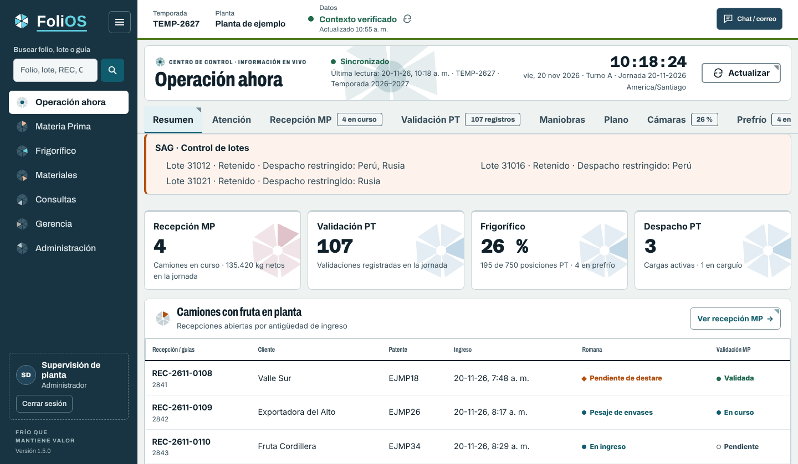
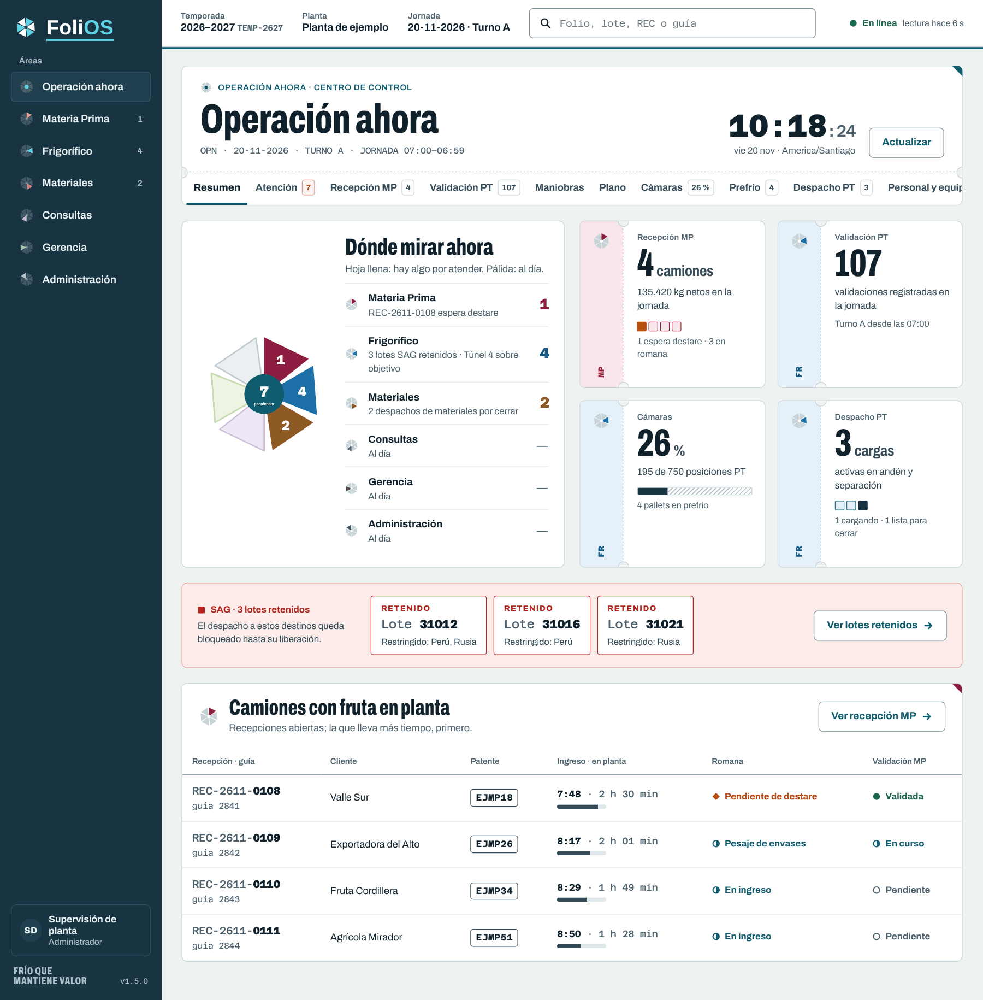
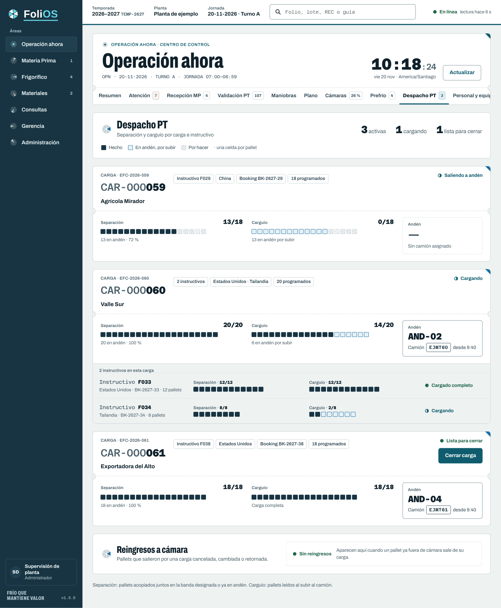
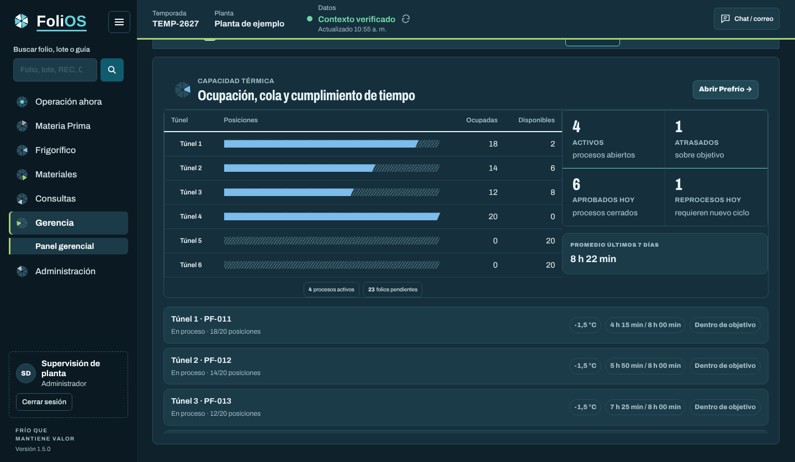
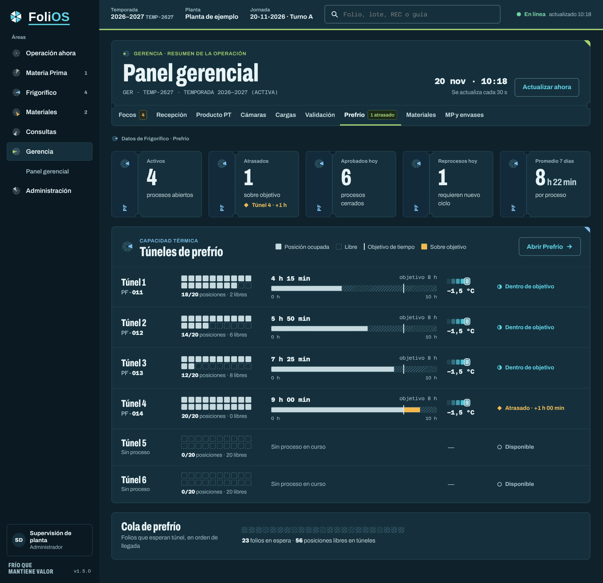
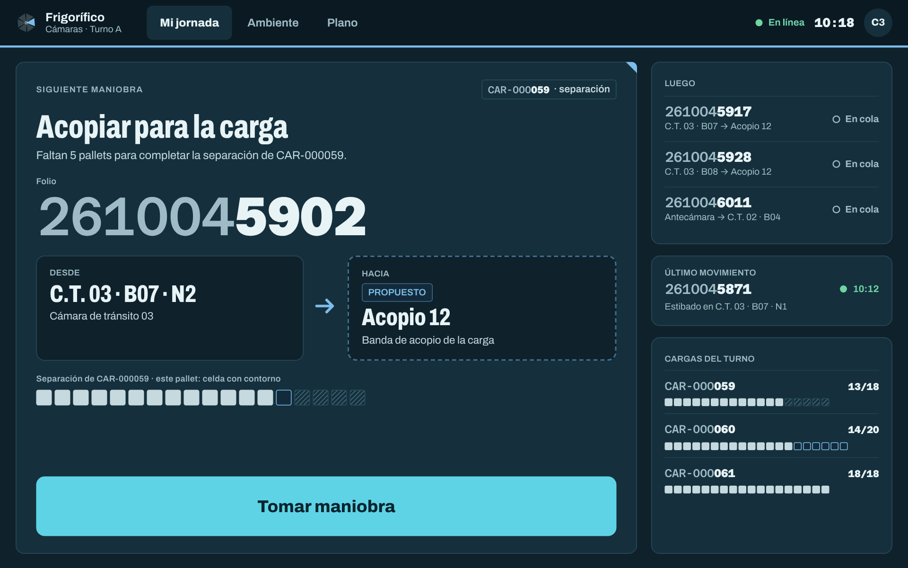

# Gajos vivos: el formato de todo FoliOS

Gajos vivos es el formato visual de **todo FoliOS**: las 82 oficinas, la tablet y la PDA. Las pantallas que se mostraron en la propuesta del 20-11-2026 son ejemplos, no el alcance. Este documento fija lo importante de la idea y cómo se adapta a cada tipo de pantalla, para que cada módulo lo adopte de la misma forma.

**Estado:**
- **Origen:** la propuesta salió de un chat en claude.ai el 20-11-2026, sobre la vista previa `FoliOS-Gajos.html` del rediseño FoliOS v2 ([../folios-v2/README.md](../folios-v2/README.md)).
- **Brecha con lo implementado:** los PR #707 y #710 aplicaron parte del rediseño, pero según L.K.S. **se quedaron cortos respecto de esta propuesta**. Este documento es la referencia para cerrar esa brecha: cada pantalla de `main` se compara con lo que se describe aquí.
- **Informe de brecha de Oficina:** [BRECHA-OFICINA.md](BRECHA-OFICINA.md), pantalla por pantalla contra `main` (22-11-2026).
- **Material de referencia:** las [capturas](capturas/) y las [maquetas](referencia/) muestran la idea. Lo que manda es este texto.

## Lo importante

Estas siete cosas definen Gajos vivos. Si una pantalla no las cumple, no está en el formato, aunque use los colores y las fuentes de FoliOS.

1. **El gajo informa, no decora.** Cada hoja es un área. Se llena, con su cifra, cuando el área tiene algo que atender, y queda pálida cuando está al día. El centro es Operación ahora y suma. Nunca hay un gajo como marca de agua ni como fondo.
2. **Cada pantalla es una etiqueta.** El encabezado, los paneles y los indicadores se arman como la etiqueta del pallet: talón con la hoja del área, perforación, troquel en la esquina y la cifra grande.
3. **El código es tipografía.** Todo código (REC, CAR, PF, lote, guía, folio, patente) va en Azeret Mono, con el prefijo apagado y el correlativo fuerte. El folio destaca sus últimos cuatro dígitos y la patente se dibuja como placa. Nunca se trunca.
4. **El color dice dónde estás; la forma, cómo está.** El color de área solo orienta: hoja, talón, regla, pestaña activa y troquel. Los estados llevan glifo y texto (● ◐ ○ ◆ ■) y nunca usan un color de área.
5. **Un pallet, una celda.** Todo lo que se cuenta en pallets, posiciones, cajas o bins se dibuja como celdas: sólida hecha, con contorno disponible y rayada por hacer. El porcentaje acompaña.
6. **El frío es una escala.** Toda temperatura se muestra sobre la misma escala de cinco tramos.
7. **El contexto se dice una vez.** Una barra con temporada, planta, jornada, búsqueda y estado de conexión, y bajo ella la regla de 3 px con el color del área abierta. Nada de eso se repite en la pantalla.

## Alcance

- **Oficina:** las 82 oficinas de `CatalogoOficinas`, en las seis áreas. Incluye Finanzas, COMEX y RRHH, que viven en Administración. Ver el [inventario](#inventario-de-pantallas).
- **Inicio y acceso:** la portada de FoliOS, el inicio de sesión y el cambio de contraseña.
- **Tablet y PDA:** todas las pantallas de `mobile/src/screens`, siempre oscuras.
- **Fuera de alcance por ahora:** los documentos impresos (PDF, etiquetas ZPL y NLBL, planillas Excel). Los leen terceros y tienen formato propio. La pantalla que los genera sí sigue el formato. Ver [Por decidir](#por-decidir).

## Lo que no cambia

- **Logo oficial:** el gajo radial con «Foli»/«OS», sin cambios.
- **Colores:** los siete colores de área y la paleta de estados de `design/estiba.tokens.json`, con sus valores actuales. Cambia dónde aparecen.
- **Tipografía:** Archivo (variable, a 66 % de ancho en los títulos) y Azeret Mono, autoalojadas.
- **Temas:** Oficina clara por defecto, con modo oscuro opcional. La tablet y la PDA van siempre oscuras porque en planta se trabaja con luz artificial.
- **Orientación:** la tablet se usa en horizontal y la PDA en vertical.
- **FoliOS no es AR:** sin nombre ni logo de planta en el código.
- **Solo presentación:** el formato no cambia lógica, datos, permisos ni acciones.
- **Temas personales:** siguen funcionando sobre las mismas variables.

## Qué corrige respecto de Gajos v2

| Tema | Gajos v2 | Gajos vivos |
| --- | --- | --- |
| El gajo | Marca de agua pálida en tarjetas y encabezado: no dice nada. | Instrumento: cada hoja llena muestra cuántos asuntos tiene su área y el centro suma. Las mismas cifras van en el menú. |
| Color de área | Casi solo en íconos chicos; indicadores del mismo color seguidos; regla de Gerencia en Operación ahora. | Hoja, talón, regla bajo la barra, pestaña activa y troquel en el color del área donde estás, y en ningún otro lado. |
| Contexto | Temporada y sincronización repetidas en barra y encabezado. | Una sola barra con temporada, planta, jornada, búsqueda y «En línea». |
| Indicadores | Tarjetas iguales con un gajo de fondo. | Tickets con el talón del área de origen del dato, perforación troquelada y troquel. |
| Avances | Barras con porcentaje. | Una celda por pallet; lo hecho es sólido y lo pendiente va rayado. |
| Códigos | Monoespaciada pareja. | Prefijo apagado y correlativo fuerte; patente como placa; folio con los últimos cuatro dígitos destacados. |
| Alertas | Franjas de color con texto corrido. | Sellos por registro (por ejemplo, «RETENIDO» por lote) con su motivo a la vista. |
| Temperatura | Número suelto. | El número sobre la escala de cinco tramos. |

| Gajos v2 | Gajos vivos |
| --- | --- |
|  |  |
|  |  |
|  |  |

## Las piezas

### El gajo

- **Orden de las hojas:** van en sentido horario desde las 12: Materia Prima (`mp`), Frigorífico (`fr`), Materiales (`ma`), Consultas (`co`), Gerencia (`ge`) y Administración (`ad`). El centro es Operación ahora (`op`).
- **Hoja llena:** color de hoja del área con la cifra adentro. Significa que hay asuntos por atender.
- **Hoja pálida:** tinte y borde del área, sin cifra. Significa que el área está al día.
- **Centro:** frost, con el total y el rótulo «por atender».
- **Usos:** el gajo completo va en el inicio, en Operación ahora y en el menú (como cifra junto a cada área). La hoja sola marca el área en el talón, el encabezado y la barra de la tablet y la PDA.

### La etiqueta

- **Talón:** columna de 62 px con el tinte del área, la hoja y la clave en mono vertical (`MP`, `FR`, `MA`, `PF`…).
- **Perforación:** línea discontinua con medialunas troqueladas en los extremos. Separa la identidad del contenido.
- **Troquel:** triángulo de 16 px en la esquina superior derecha, en el color de hoja del área.
- **Cifra:** Archivo angosto 800, con la unidad más chica en el mismo renglón.
- **Encabezado de pantalla:** rótulo del área con su hoja, título de 60 px y línea de código mono (por ejemplo `OPN · 20-11-2026 · TURNO A · JORNADA 07:00–06:59`). Debajo van la perforación y las pestañas con contadores cortos.
- **Talón en paneles transversales:** en paneles que reúnen varias áreas (Gerencia, Operación ahora, Búsqueda), el talón lleva la hoja del área **de donde viene el dato**.

### Códigos

- **Tipografía:** Azeret Mono. El prefijo usa el color de rótulo y peso 500; el correlativo, tinta y peso 800. Ejemplos: `REC-2611-`**`0108`**, `CAR-000`**`059`**, `PF-`**`014`**, `Lote `**`31012`**, `guía `**`2841`**.
- **Folio:** los últimos cuatro dígitos destacados (76 px en la tablet, 40 px en la PDA, y 15 a 30 px en Oficina según el lugar).
- **Patente:** como placa, con un borde de 1,5 px.

### Estados

| Glifo | Estado | Color | Ejemplos |
| --- | --- | --- | --- |
| ● | Listo | éxito | Validada, cargado completo, aprobado |
| ◐ | En curso | frost | Pesaje de envases, cargando, en proceso |
| ○ | Pendiente | rótulo | Por validar, por separar, sin camión |
| ◆ | Atención | sello | Pendiente de destare, túnel atrasado, por vencer |
| ■ | Bloqueado | crítico | Lote retenido SAG, rechazo, anulado con bloqueo |

Cada estado de los enums `Estado*` se asigna a uno de estos cinco. Ningún estado usa un color de área.

### Celdas

- **Tamaño:** 14 px en Oficina, 22 px en la tablet y 11 px en columnas angostas.
- **Sólida:** hecho, ocupado o cargado.
- **Contorno con tinte del área:** disponible, en andén, reservada o la siguiente.
- **Rayada (trama de «escarcha» a 135°):** por hacer.
- **Borde discontinuo:** libre.
- **Color sello:** sobre objetivo.
- **Grilla física:** una celda por pallet, posición, caja o bin. Si el espacio físico tiene forma (túnel de 2 × 10, banda o nivel de cámara), la grilla la respeta.

### Escala de frío

- **Tramos:** cinco, más de 8, de 4 a 8, de 2 a 4, de 0 a 2 y bajo 0 °C, dibujados como bloques de 9 × 12 px del más claro al frost. El tramo del valor lleva contorno.
- **Dónde va:** en toda temperatura de Prefrío, Ambiente, Punto de rocío, Hidrocooler, cámaras y umbrales.

### Barra de contexto

- **Contenido:** temporada con su código, planta, jornada, búsqueda global (folio, lote, REC o guía) y «En línea · lectura hace X s».
- **Regla del área:** debajo va la regla de 3 px con el color del área abierta.

## Cómo se adapta a cada tipo de pantalla

Las 82 oficinas caben en nueve tipos. Conviene migrar cada tipo una vez, en su componente común, y que las pantallas lo hereden.

| Tipo | Cómo se ve en Gajos vivos |
| --- | --- |
| **Resumen de área** (la portada de cada área y Operación ahora) | Encabezado etiqueta con la hoja del área. Una «hoja de atención» con la cifra del área y la lista de lo que hay que atender, cada ítem con su código y su glifo. Debajo, tickets con talón para los indicadores del área y accesos a sus submódulos como etiquetas pequeñas. Operación ahora muestra el gajo completo («Dónde mirar ahora»). |
| **Bandeja** (listas y tablas: Romana, Lotes, Cargas, Despachos, Expedientes…) | La tabla dentro de una etiqueta con el troquel del área y un título con su hoja. La primera columna es el código como tipografía. Los estados llevan glifo y la antigüedad, una barra corta. Los filtros van en una franja sobre la tabla. El estado vacío explica cuándo aparece algo. Las filas que requieren acción van primero. |
| **Detalle** (una carga, una recepción, un lote, un expediente, una nota de venta) | El registro como etiqueta: código grande (como `CAR-000059`), datos clave en chips y estado con glifo. Bajo la perforación, las secciones. Las cantidades en pallets van como celdas. El historial se dibuja como talones fechados. Hay una sola acción principal. |
| **Captura** (validación, digitación, recepciones, cambios de atributos) | El formulario como etiqueta. Arriba, el código del registro que se crea o corrige. Los campos van agrupados por perforaciones y cada dato traído de otro sistema muestra su estado (● coincide / ◆ revisar). Los errores van junto al campo. Hay un solo botón principal. |
| **Tablero** (Panel gerencial, Salud operacional, Supervisión, Estatus operativo, Prefrío) | Tickets con el talón del área de origen. Celdas para pallets y posiciones, y escala para temperaturas. Tiempo contra objetivo con una marca vertical y el exceso en sello. |
| **Plano** (Cámaras, Capacidad de bodegas, Diagramas SAG/USDA, configuración de cámaras) | Una celda por posición, con la forma física real (banda, nivel). El color de área va solo en el marco. Ocupada sólida, libre discontinua y reservada con contorno. Los bloqueos llevan glifo. |
| **Calendario** (Calendario de embarques, Labores por turno, Control de personal) | Cada evento es una etiqueta pequeña con su código y estado. El día actual se marca con la regla del área. |
| **Configuración** (accesos, maestros, catálogos, tarifario, configuración de COMEX) | Una etiqueta por sección, con los códigos en mono. Sin gajo de atención. Los cambios sensibles muestran motivo y autor. |
| **Impresión** (Etiquetas PT, Etiquetas de materiales, R-24) | La pantalla sigue el formato. El documento impreso conserva su diseño propio. |

**Estados transversales en todos los tipos:**
- **Vacío:** explica cuándo aparece algo.
- **Cargando:** el esqueleto tiene la forma de la etiqueta.
- **Error:** dice qué pasó y qué hacer.
- **Sin conexión:** glifo ◆ y la hora de la última lectura.
- **Solo lectura:** se dice en el encabezado, no se deshabilita en silencio.
- **Diálogos:** una acción principal; las destructivas, en crítico y con glifo ■.

**Tablet y PDA** (siempre oscuras):
- **Barra navy:** el gajo con la hoja del área, área · módulo · turno, «En línea», la hora y las iniciales.
- **Una tarea, una etiqueta:** folio grande con los últimos cuatro dígitos destacados, DESDE → HACIA (lo propuesto con borde discontinuo), celdas de lo que se está completando y un solo botón grande (84 px en la tablet, 56 px en la PDA).
- **Captura con escáner:** el folio o código escaneado arriba como etiqueta y debajo cada dato con su estado.

**Inicio y acceso:**
- **Inicio:** el gajo completo con las cifras de las áreas que el usuario puede ver.
- **Acceso:** el inicio de sesión y el cambio de contraseña muestran el gajo sin cifras.

## El gajo de atención en todas las áreas

Cada cifra sale de un conteo que el backend ya calcula o que debe calcular. La interfaz no inventa umbrales. Fuentes sugeridas, por confirmar:

| Hoja | Cuenta como «por atender» |
| --- | --- |
| Materia Prima | Camiones que esperan destare o Validación MP; recepciones con estado de atención; lotes por digitar. |
| Frigorífico | Lotes SAG retenidos; túneles sobre objetivo; discrepancias abiertas; maniobras pausadas; cargas listas para cerrar. |
| Materiales | Despachos por cerrar; ítems bajo nivel de reposición; vencimientos próximos; recepciones provisionales cerca de su plazo. |
| Consultas | Sin cifra por ahora: es un área de referencia. |
| Gerencia | Los focos del Panel gerencial. |
| Administración | Alertas de Salud operacional; prefacturas del mes por cerrar; expedientes COMEX con documentos pendientes. |
| Centro (Operación ahora) | La suma de las hojas que el usuario puede ver. |

El primer corte usa `GET /api/oficina/atencion` para el Inicio FoliOS, el menú de Oficina y el resumen de Operación ahora. El Inicio se abre desde el menú y conserva el destino de acceso configurado por perfil.

| Hoja | Fuentes conectadas |
| --- | --- |
| Materia Prima | Ingresos de Portería sin revisar y camiones con fruta por destarar. |
| Frigorífico | Retenciones generales SAG, discrepancias abiertas y túneles sobre su objetivo vigente. |
| Materiales | Despachos pendientes o parciales y folios próximos a vencer según el plazo del ítem. |
| Consultas | Acceso de referencia sin cifra. |
| Gerencia | Focos de la lectura en caché del Panel gerencial. |
| Administración | Hallazgos activos de la última auditoría de Salud operacional completada, cuando la ejecución más reciente concluyó correctamente. |

Cada hoja enlaza a sus fuentes habilitadas. El centro muestra el total conocido y avisa si falta una lectura. Las otras fuentes de la propuesta quedan pendientes de definir con sus reglas de operación y permisos.

## Inventario de pantallas

### Oficina

| Hoja | Pantalla | Ruta | Tipo | Lo que más cambia |
| --- | --- | --- | --- | --- |
| Materia Prima | Resumen | `/oficina/materia-prima` | Resumen de área | Hoja de atención de MP y tickets con talón MP. |
| Materia Prima | Ingresos Portería | `/oficina/porteria` | Bandeja + Captura | Correlativo PORT con prefijo apagado; patente como placa. |
| Materia Prima | Romana | `/oficina/romana` | Bandeja + Captura | REC-… con prefijo apagado; tandas de pesaje como celdas; estados con glifo. |
| Materia Prima | Defectos de recepción | `/oficina/materia-prima/defectos-recepcion` | Bandeja | — |
| Materia Prima | Digitación de Lotes | `/oficina/materia-prima/lotes` | Captura + Bandeja | El lote como etiqueta; CSG y guía en mono. |
| Materia Prima | Recepción por CSG | `/oficina/materia-prima/recepciones-csg` | Bandeja | — |
| Materia Prima | Hidrocooler | `/oficina/materia-prima/hidrocooler` | Captura + Bandeja | Temperaturas con la escala de frío. |
| Materia Prima | Órdenes de Proceso | `/oficina/materia-prima/ordenes-proceso` | Bandeja + Detalle | Versión de la orden en el código; bins pendientes como celdas. |
| Materia Prima | Fruta a Proceso | `/oficina/materia-prima/fruta-a-proceso` | Captura + Bandeja | Bins de la orden como celdas. |
| Materia Prima | Despacho Comercial | `/oficina/materia-prima/despacho-comercial` | Bandeja + Captura | — |
| Materia Prima | Existencias MP | `/oficina/materia-prima/existencias` | Bandeja | — |
| Materia Prima | Cuenta Envases | `/oficina/envases/cuenta-corriente` | Bandeja + Detalle | Guías en mono; ingresos y salidas con glifo, no con color de área. |
| Materia Prima | Despacho Envases | `/oficina/envases/despachos` | Bandeja + Captura | — |
| Frigorífico | Resumen | `/oficina/frigorifico` | Resumen de área | Hoja de atención de Frigorífico y tickets con talón FR. |
| Frigorífico | Validación | `/oficina/validacion` | Captura + Bandeja | Folio con los últimos cuatro destacados. |
| Frigorífico | Pendientes por validar | `/oficina/validacion/pendientes` | Bandeja | Distribución por CSG y lote como celdas. |
| Frigorífico | Etiquetas PT | `/oficina/validacion/etiquetas` | Impresión | La pantalla sigue el sistema; la etiqueta impresa conserva su formato. |
| Frigorífico | Recepción de fruta embalada | `/oficina/recepcion-fruta-embalada` | Captura + Bandeja | — |
| Frigorífico | Repaletizajes | `/oficina/validacion/repaletizajes` | Bandeja + Captura | Orígenes y destino como celdas por pallet. |
| Frigorífico | Anulaciones | `/oficina/validacion/anulaciones` | Bandeja | Estado anulado con glifo propio y motivo visible. |
| Frigorífico | Contraparte SAG | `/oficina/frigorifico/contraparte-sag` | Bandeja + Captura | Condición SAG con sello. |
| Frigorífico | Lotes retenidos SAG | `/oficina/frigorifico/lotes-retenidos-sag` | Bandeja + Detalle | Sello RETENIDO por lote con su restricción de destino. |
| Frigorífico | Inspección SAG | `/oficina/frigorifico/inspeccion-sag` | Bandeja + Detalle | — |
| Frigorífico | Diagramas SAG/USDA | `/oficina/frigorifico/diagramas-sag` | Plano | Ya es una celda por caja: alinear celdas y sellos al sistema. |
| Frigorífico | Prefrío | `/oficina/prefrio` | Tablero + Bandeja | Túneles en 2 × 10, tiempo contra objetivo y escala de frío. |
| Frigorífico | Punto de rocío | `/oficina/prefrio/punto-rocio` | Tablero | Escala de frío; margen con glifo de atención. |
| Frigorífico | Cámaras | `/oficina/frigorifico/camaras` | Plano | Una celda por posición: ocupada, libre, reservada. |
| Frigorífico | Control de personal | `/oficina/frigorifico/control-personal` | Calendario + Bandeja | — |
| Frigorífico | Labores por turno | `/oficina/frigorifico/labores-turno` | Calendario | — |
| Frigorífico | Discrepancias | `/oficina/frigorifico/discrepancias` | Bandeja | Cada discrepancia con glifo de atención y su código. |
| Frigorífico | Cargas | `/oficina/frigorifico/despacho/cargas` | Bandeja + Detalle | Cada carga como etiqueta con separación y carguío en celdas. |
| Frigorífico | Estatus operativo | `/oficina/frigorifico/despacho/estatus` | Tablero | Cargas en celdas por pallet. |
| Frigorífico | Calendario de embarques | `/oficina/frigorifico/despacho/calendario` | Calendario | Cada carga como etiqueta en su día; estado con glifo. |
| Frigorífico | Control de despacho (R-24) | `/oficina/frigorifico/control-despacho` | Impresión + Bandeja | La pantalla sigue el sistema; la planilla impresa conserva su formato. |
| Frigorífico | Existencias PT | `/oficina/frigorifico/existencias` | Bandeja | — |
| Materiales | Resumen | `/oficina/materiales` | Resumen de área | Hoja de atención de Materiales y tickets con talón MA. |
| Materiales | Catálogos | `/oficina/materiales/catalogos` | Configuración | — |
| Materiales | Ítems · niveles de stock | `/oficina/materiales/items/niveles` | Configuración | Nivel actual contra mínimo y reposición como celdas o barra. |
| Materiales | Ítems | `/oficina/materiales/items` | Configuración + Bandeja | — |
| Materiales | Recepciones | `/oficina/materiales/recepciones` | Bandeja + Captura | Provisionales con plazo como estado de atención. |
| Materiales | Etiquetas | `/oficina/materiales/recepcion` | Impresión | La etiqueta impresa conserva su formato. |
| Materiales | Inventario BC | `/oficina/materiales/inventario` | Bandeja | — |
| Materiales | Capacidad de bodegas | `/oficina/materiales/capacidad` | Plano + Tablero | Una celda por posición de bodega. |
| Materiales | Supervisión | `/oficina/materiales/supervision` | Tablero | — |
| Materiales | Vencimientos | `/oficina/materiales/vencimientos` | Bandeja | Próximos a vencer con glifo de atención. |
| Materiales | Reposición | `/oficina/materiales/reposicion` | Bandeja | Bajo nivel de reposición con glifo de atención. |
| Materiales | Tomas de inventario | `/oficina/materiales/tomas` | Captura + Bandeja | — |
| Materiales | Inventario CC | `/oficina/materiales/almacenes` | Bandeja | — |
| Materiales | Despachos | `/oficina/materiales/despachos` | Bandeja + Captura | — |
| Materiales | Recetas | `/oficina/materiales/recetas` | Configuración | — |
| Materiales | Estándares de consumo | `/oficina/materiales/estandares` | Configuración + Bandeja | — |
| Materiales | Rebaja por estándar | `/oficina/materiales/rebajas-estandar` | Bandeja | Rebaja parcial pendiente con glifo de atención. |
| Materiales | Consumos por OT | `/oficina/materiales/consumos` | Bandeja | — |
| Materiales | Órdenes | `/oficina/materiales/ordenes` | Bandeja + Detalle | — |
| Materiales | Existencias | `/oficina/materiales/exportaciones` | Bandeja | — |
| Administración | Resumen | `/oficina/administracion` | Resumen de área | Hoja de atención de Administración (Finanzas, COMEX y RRHH incluidos). |
| Operación ahora (centro) | Operación ahora | `/oficina/operacion-ahora` | Resumen de área | Centro del gajo: «Dónde mirar ahora» con las seis hojas. |
| Gerencia | Panel Gerencial | `/oficina/gerencia` | Tablero | Talón con la hoja del área de origen de cada dato. |
| Administración | Accesos & Temporadas | `/oficina/accesos` | Configuración | — |
| Administración | Plantas y umbrales de prefrío | `/oficina/administracion/fruta-embalada` | Configuración | Umbrales mostrados sobre la escala de frío. |
| Administración | Maestros de temporada | `/oficina/administracion/maestros-temporada` | Configuración | — |
| Administración | Configuración de cámaras | `/oficina/administracion/camaras` | Configuración + Plano | Vista previa de la cámara en celdas. |
| Administración | Salud operacional | `/oficina/administracion/integridad-operacional` | Tablero + Bandeja | Cada alerta con glifo de atención o bloqueo. |
| Administración | Cambio de atributos PT | `/oficina/administracion/atributos-pt` | Captura | Folio con los últimos cuatro destacados; motivo obligatorio visible. |
| Administración | Demo comercial | `/oficina/demo` | Configuración | — |
| Administración · Finanzas | Hechos valorizables | `/oficina/finanzas/hechos` | Bandeja | — |
| Administración · Finanzas | Tarifario | `/oficina/finanzas/tarifario` | Configuración | — |
| Administración · Finanzas | Proveedores | `/oficina/finanzas/proveedores` | Bandeja + Detalle | Documentos SII con tipo y folio en mono. |
| Administración · Finanzas | Costos COMEX | `/oficina/finanzas/costos-comex` | Bandeja | — |
| Administración · Finanzas | Prefactura | `/oficina/finanzas/prefactura` | Detalle + Bandeja | La prefactura como etiqueta con su periodo en la línea de código. |
| Administración · RRHH | Personal y dotación | `/oficina/rrhh` | Bandeja + Detalle | — |
| Administración · RRHH | Puesto de marcaje | `/oficina/rrhh/marcaje` | Captura | Pantalla de kiosco: una acción, cifras grandes. |
| Administración · COMEX | Expedientes de embarque | `/oficina/comex/expedientes` | Bandeja + Detalle | Documentos del expediente con estado y glifo. |
| Administración · COMEX | Configuración Comex | `/oficina/comex/configuracion` | Configuración | — |
| Administración · COMEX | Actores y lugares | `/oficina/comex/comercial` | Configuración | — |
| Administración · COMEX | Notas de venta | `/oficina/comex/notas` | Bandeja + Detalle | Versión de la nota en la línea de código. |
| Administración · COMEX | Bookings y contenedores | `/oficina/comex/bookings` | Bandeja + Detalle | Reservas por contenedor como celdas. |
| Consultas | Resumen | `/oficina/consultas` | Resumen de área | Sin cifra de atención por ahora (ver «Por decidir»). |
| Consultas | Búsqueda Operacional | `/oficina/consultas/busqueda` | Bandeja | Resultados con código como tipografía; cada uno con la hoja de su área. |
| Consultas | Trazabilidad de lotes | `/oficina/consultas/trazabilidad` | Detalle | La cadena como etiquetas unidas por perforaciones. |
| Consultas | Productores SAG / CSG | `/oficina/consultas/sag` | Bandeja | — |
| Consultas | Productores Verificados | `/oficina/consultas/productores` | Bandeja | — |

### Tablet y PDA (`mobile/src/screens`)

| Hoja | Pantalla | Lo que más cambia |
| --- | --- | --- |
| — | `LoginScreen`, `FirstPasswordChangeScreen` | Gajo completo sin cifras; campos de 56 px. |
| Frigorífico | `OperationalWorkspaceScreen` (Mi jornada) | La maniobra como etiqueta: folio de 76 px, DESDE → HACIA, celdas de la carga y botón único de 84 px. |
| Frigorífico | `OperationalScreen` (Plano y operación) | Una celda por posición de cámara; folios con los últimos cuatro destacados. |
| Frigorífico | `EnvironmentalControlScreen` (Ambiente) | Cada cámara con su temperatura sobre la escala de frío. |
| Frigorífico | `ConsolidationScreen` | Pallets de la consolidación como celdas. |
| Frigorífico | `PrefrioScreen`, `PrefrioWorkspaceScreen`, `PrefrioPartialDialog` | Túnel en 2 × 10 celdas, tiempo contra objetivo y escala de frío. |
| Frigorífico | `DewPointScreen` | Escala de frío y margen con glifo de atención. |
| Frigorífico | `RepalletizingScreen`, `RepackingEditor` | Orígenes y destino como celdas; folios con los últimos cuatro destacados. |
| Frigorífico | `PackedFruitReceptionScreen` | Captura como etiqueta, con el estado de cada dato. |
| Frigorífico | `SagCounterpartScreen` | Condición SAG con sello. |
| Frigorífico | `ValidationScreen`, `ValidationWorkspaceScreen` (Validación PT) | Folio escaneado como etiqueta y datos de planta con ● coincide / ◆ revisar. |
| Materia Prima | `ValidationMpScreen` | Segmentos y envases como celdas; CSG y guía en mono. |
| Materia Prima | `GatehouseScreen` (Portería) | Patente como placa y correlativo PORT. |
| Materia Prima | `HidrocoolerMpScreen` | Temperatura y estado del agua sobre la escala de frío. |
| Materia Prima | `FrutaProcesoScreen` | Bins de la orden como celdas. |
| Materiales | `MaterialReceptionScreen` | Captura como etiqueta, con el código de la recepción arriba. |
| Administración | `DemoDataScreen` (datos de demostración) | Configuración como etiquetas. |

## Pantallas de ejemplo

Estas cinco pantallas se diseñaron completas y sirven de patrón para las demás. Las maquetas estáticas están en [`referencia/pantallas/`](referencia/pantallas/): abren desde el repositorio con las fuentes de `node_modules` (requiere `npm ci`) y el logo de `public/brand/folios/`. Las clases de las piezas están en [`referencia/gajos-vivos.css`](referencia/gajos-vivos.css), que es una referencia de diseño, no CSS de producción.

### Operación ahora → Resumen (tipo Resumen de área)

1. **Barra de contexto** y regla frost.
2. **Encabezado etiqueta** con el reloj grande (46 px, mono) y el botón «Actualizar».
3. **Pestañas** con contadores cortos: Resumen, Atención (7, en sello), Recepción MP (4), Validación PT (107), Maniobras, Plano, Cámaras (26 %), Prefrío (4), Despacho PT (3) y Personal y equipos.
4. **«Dónde mirar ahora»:** gajo de atención de 196 px y la lista de las seis áreas. Cada fila lleva la hoja, el nombre, el detalle y la cifra, o «—» y «Al día».
5. **Cuatro tickets (2 × 2):**
   - **Recepción MP:** 4 camiones, con una celda por camión.
   - **Validación PT:** 107 validaciones registradas en la jornada.
   - **Cámaras:** 26 % (195 de 750 posiciones PT), con una barra sólida y el resto rayado.
   - **Despacho PT:** 3 cargas, con una celda por carga.
6. **Franja SAG:** un sello «RETENIDO» por lote, con el número en mono y «Restringido: Perú, Rusia».
7. **«Camiones con fruta en planta»** (tipo Bandeja), ordenada por antigüedad. Columnas:
   - **Recepción · guía:** código y guía.
   - **Cliente.**
   - **Patente:** como placa.
   - **Ingreso · en planta:** hora, tiempo en planta y barra de antigüedad.
   - **Romana y Validación MP:** el estado con su glifo.

### Operación ahora → Despacho PT (tipo Bandeja con detalle)

1. **Encabezado de sección:** hoja de Frigorífico, contadores (activas, cargando, lista para cerrar) y la leyenda de las celdas.
2. **Una etiqueta por carga:**
   - **Arriba:** «CARGA · EFC-…», el código CAR grande, el cliente, chips con el instructivo, el destino, el booking y los pallets programados, y el estado con su glifo.
   - **Bajo la perforación, tres columnas:** Separación (celdas y «13 en andén · 72 %»), Carguío (cargado sólido, en andén por subir con contorno y el resto rayado) y Andén.
   - **Andén:** el código, la patente y desde qué hora. Sin camión, con borde discontinuo.
3. **Cargas con varios instructivos:** una subfila por instructivo, con sus celdas y su estado.
4. **Acción principal:** una sola, «Cerrar carga», y solo en la carga lista.
5. **Reingresos a cámara:** con un estado vacío que explica cuándo aparecen.

### Gerencia → Panel gerencial → Prefrío (tipo Tablero)

1. **Contexto:** regla verde (Gerencia) y pestañas con contadores (Focos 4, Prefrío «1 atrasado»).
2. **Cinco tickets con talón PF:** Activos, Atrasados (◆ Túnel 4 · +1 h), Aprobados hoy, Reprocesos hoy y Promedio 7 días.
3. **Túneles,** una fila por túnel:
   - **Nombre y proceso:** el nombre del túnel y su código PF.
   - **Posiciones:** 2 × 10.
   - **Tiempo contra objetivo:** barra de 0 a 10 h, con la marca en 8 h y el exceso en sello.
   - **Temperatura** sobre la escala de frío.
   - **Estado** con su glifo. Sin proceso: «Disponible».
4. **Cola de prefrío:** celdas rayadas por folio en espera, con las posiciones libres.

### Tablet → Mi jornada (1280 × 800)

- **Barra navy** con el gajo de Frigorífico y las pestañas Mi jornada, Ambiente y Plano y operación.
- **Siguiente maniobra:** etiqueta con el chip de la carga, el folio de 76 px, DESDE → HACIA, las celdas de la separación con este pallet en contorno y el botón «Tomar maniobra».
- **Columna lateral:** Luego, Último movimiento y Cargas del turno.

### PDA → Validación PT (360 × 740)

- **Folio escaneado** como etiqueta.
- **Datos de planta** con ● Coincide / ◆ Revisar.
- **Botones de 56 px:** «Confirmar validación» y «Corregir un dato».

### Lámina del sistema

[Lámina completa](capturas/lamina-sistema.png): las reglas, el gajo, los colores, la tipografía, los estados y la etiqueta numerada.

## Colores

Todos los valores vienen de `design/estiba.tokens.json`.

| Nombre | Uso | Claro | Oscuro |
| --- | --- | --- | --- |
| Papel | Fondo de página | `#EEF2F1` | `#0F212B` |
| Etiqueta | Tarjetas y campos | `#FFFFFF` | `#15303C` |
| Tinta | Títulos y texto | `#10212B` | `#E8F3F6` |
| Rótulo | Rótulos y metadatos | `#4C616C` | `#9FBCC6` |
| Regla | Bordes | `#C8D3D7` | `#2A4D5C` |
| Navy | Menú lateral | `#183442` | `#0B1A22` |
| Frost | Marca y acción principal | `#0F5C6E` | `#5FD3E6` |
| Sello | Atención | `#B4500B` | `#F3B94F` |
| Crítico | Bloqueo y rechazo | `#B3261E` | `#FF8B7B` |
| Éxito | Listo, aprobado | `#1E6B45` | `#6FD6A0` |

| Área | Clave | Hoja (claro) | Texto (claro) | Tinte (claro) | Hoja (oscuro) |
| --- | --- | --- | --- | --- | --- |
| Operación ahora | `op` | `#0F5C6E` | `#0F5C6E` | `#E3F1F4` | `#5FD3E6` |
| Materia Prima | `mp` | `#8C1D40` | `#8C1D40` | `#F8E6EC` | `#F2879F` |
| Frigorífico | `fr` | `#1D6FA8` | `#15588A` | `#E5F0F8` | `#7DBCEB` |
| Materiales | `ma` | `#8C5A22` | `#75491A` | `#F5ECE1` | `#E0AA6C` |
| Consultas | `co` | `#5E3F91` | `#5E3F91` | `#EEE8F6` | `#BBA2EA` |
| Gerencia | `ge` | `#4C7A1C` | `#3E5F14` | `#EDF4E3` | `#A6D16E` |
| Administración | `ad` | `#4B5862` | `#4B5862` | `#ECEFF1` | `#B7C4CC` |

La única excepción son los cinco tonos de la escala de frío (`#C9DDE2`, `#9FCAD4`, `#5FB0C2`, `#2C8AA0` y `#0F5C6E` en claro), que son propios de la propuesta y habría que agregarlos a los tokens.

## Plan de adopción

1. **Piezas base, una sola vez:** etiqueta (talón, perforación y troquel), código, glifos de estado, celdas, escala de frío y gajo de atención, como componentes Blade (`x-folios.*`) y React Native, con las clases en `folios-components.css`. Los tonos de la escala de frío entran a los tokens.
2. **Armazón de Oficina en todas las oficinas a la vez:** barra de contexto única, regla del área, encabezado etiqueta con pestañas y menú con cifras. Se eliminan los gajos de marca de agua de todo el código.
3. **Por tipo de pantalla:** se migra el componente común de cada uno de los nueve tipos y se recorren sus pantallas del inventario. Se empieza por Bandeja y Detalle, que cubren la mayoría.
4. **Gajo de atención:** un conteo por área en el backend, con las fuentes de la tabla de arriba, que alimenta el inicio, Operación ahora y el menú.
5. **Pantallas de ejemplo según su especificación:** Resumen, Despacho PT y Prefrío de Gerencia.
6. **Tablet y PDA, todas las pantallas:** barra con el gajo, tarea como etiqueta, folios, celdas, escala y glifos.
7. **Guardas en CI** para no retroceder:
   - Ningún gajo decorativo.
   - Todo estado mapeado a un glifo.
   - Los códigos pasan por el componente de código.
   - Una sola acción principal por vista.
   - Contraste en claro y oscuro.

## Definición de terminado (por pantalla)

Una pantalla está en Gajos vivos cuando cumple todo esto:

- [ ] Usa la barra de contexto y la regla de su área; no repite la temporada ni la conexión.
- [ ] El encabezado es una etiqueta: hoja del área, título y línea de código.
- [ ] Sus paneles son etiquetas con el troquel del área; los indicadores, tickets con talón.
- [ ] Todo código va en mono con el prefijo apagado; los folios, con los últimos cuatro destacados; las patentes, como placa.
- [ ] Todo estado tiene glifo y texto; ningún estado, cifra ni botón usa un color de área.
- [ ] Lo que se cuenta en pallets, posiciones, cajas o bins se ve como celdas.
- [ ] Toda temperatura usa la escala de frío.
- [ ] Tiene una sola acción principal por vista.
- [ ] No tiene gajos decorativos.
- [ ] Funciona en claro y en oscuro (Oficina), o en oscuro (tablet y PDA), con contraste verificado.
- [ ] Los estados vacío, cargando, error y sin conexión están resueltos.

## Por decidir

- **Fuentes del gajo de atención:** confirmar qué cuenta en cada área (ver la tabla de fuentes).
- **Consultas:** decidir si lleva cifra en el gajo o si su hoja queda siempre como referencia.
- **Escala de frío:** confirmar los cinco tramos con Calidad, quizás por especie.
- **Reloj grande de Operación ahora:** puede quedarse (sirve en la sala de control) o reemplazarse por la lectura de la barra.
- **Documentos impresos:** decidir si los PDF y las planillas internas adoptan parte del formato (encabezado etiqueta y códigos) o se quedan como están.
- **Finanzas, COMEX y RRHH:** hoy usan la hoja de Administración. Falta confirmar si basta con un sub-rótulo (FINANZAS, COMEX o RRHH) en la etiqueta.
